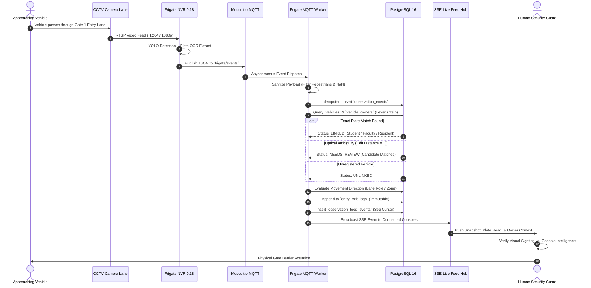
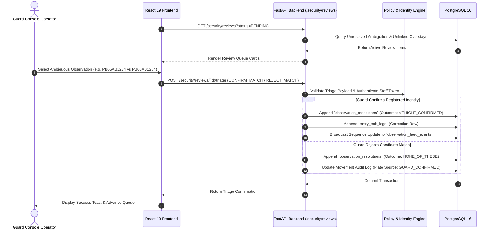
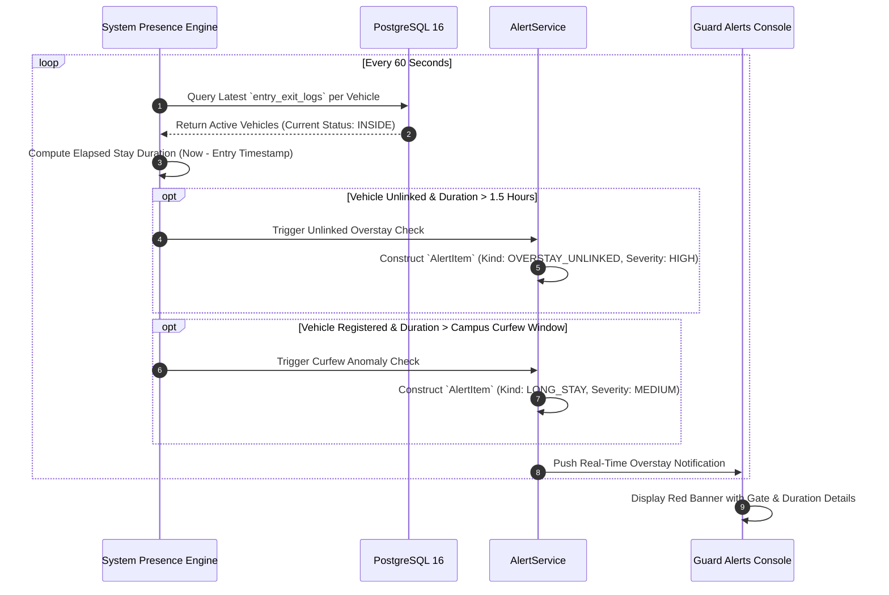
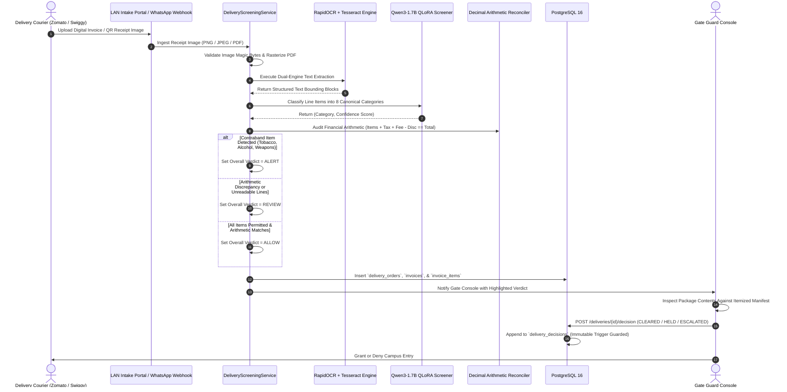
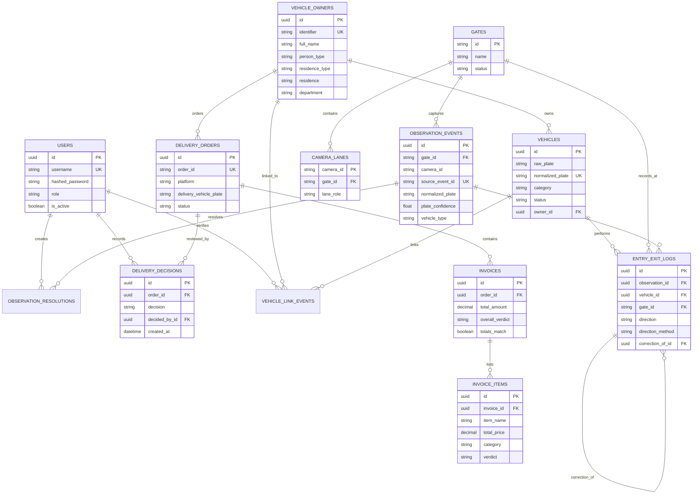

# CVS-ACS System Documentation Overview
## Campus Vehicle Security & Access Control System
### Production Architectural Blueprint, Data Flow Specifications & Machine Learning Pipelines

**Deployment Site:** Punjab Engineering College (PEC), Sector 12, Chandigarh (`GATE_1`, `GATE_2`, `GATE_3`)  
**Repository Root:** [/home/kirat/coding/honours](file:///home/kirat/coding/honours)  
**System Mandate:** $\mathbf{OBSERVE} \longrightarrow \mathbf{ASSOCIATE} \longrightarrow \mathbf{CONTEXTUALIZE} \longrightarrow \mathbf{RECORD} \longrightarrow \mathbf{ALERT}$  
*Physical barriers and campus perimeter gates are operated exclusively by human security personnel. The system acts as an authoritative campus intelligence brain and forensic audit journal; it never autonomously actuates gate barriers.*

---

## 1. System Mission & Operational Mandate

The Campus Vehicle Security & Access Control System (**CVS-ACS**) provides automated, continuous situational intelligence across heterogeneous vehicle traffic entering and leaving the 146-acre Punjab Engineering College (PEC) campus.

### 1.1 Core Operational Invariants
1. **Human-in-the-Loop Barrier Operation:** AI and computer vision models identify license plates, recognize vehicle types, parse delivery receipts, and detect policy violations. However, gate barriers are physically operated by human guards. The system informs and audits; guards make gate decisions.
2. **Immutable Forensic Journaling:** Vehicle crossings, guard resolutions, and delivery screening decisions are written to append-only database tables (`entry_exit_logs`, `observation_resolutions`, `delivery_decisions`). PostgreSQL triggers prevent `UPDATE`, `DELETE`, and `TRUNCATE` operations on historical records.
3. **Strict Separation of Perception and Security Policy:** Probabilistic machine learning pipelines output classification probabilities and confidence scores. Deterministic institutional policy engines evaluate statutory campus rules, guaranteeing predictable, legally defensible, and auditable outcomes.
4. **Resilient Offline First Architecture:** Edge video telemetry and guard consoles continue operating during external network outages using local Mosquitto MQTT, local PostgreSQL storage, and on-premises OCR inference engines.

---

## 2. High-Level Architectural Blueprint

```
+----------------------------------------------------------------------------------------------------+
|                                    PERIMETER TELEMETRY INGESTION                                   |
|   PEC Gate 1 (Main Sector 12)       PEC Gate 2 (Hostels / Sports)       PEC Gate 3 (Faculty Complex)|
|   [RTSP H.264/H.265 Cameras]        [RTSP H.264/H.265 Cameras]          [RTSP H.264/H.265 Cameras]  |
+----------------------------------------------------------------------------------------------------+
                                                  │
                                                  ▼
+----------------------------------------------------------------------------------------------------+
|                                    EDGE COMPUTATION & SENSOR HUB                                   |
|   Frigate NVR 0.18.0 (VAAPI Hardware Video Decode) + Secondary Optical Character Recognition       |
|   Docker Container `campus_frigate` (Host Port 5000 / RTSP 8554)                                   |
|   Config: config/frigate/config.yml                                                                |
+----------------------------------------------------------------------------------------------------+
                                                  │  MQTT Telemetry Stream (`frigate/events`)
                                                  ▼
+----------------------------------------------------------------------------------------------------+
|                                    ASYNCHRONOUS TELEMETRY BUS                                      |
|   Eclipse Mosquitto 2.1.2 MQTT Message Broker                                                      |
|   Docker Container `campus_mosquitto` (Host Port 1883)                                             |
+----------------------------------------------------------------------------------------------------+
                                                  │
                         ┌────────────────────────┴────────────────────────┐
                         ▼                                                 ▼
+---------------------------------------------------+     +------------------------------------------+
|          FASTAPI CORE BACKEND ENGINE              |     |          N8N WORKFLOW ENGINE             |
|   Python 3.14 (.venv) | Uvicorn Server (Port 8000)|     |   Docker Container `campus_n8n` (Port    |
|   File: backend/app/main.py                       |     |   5678) Webhook Automations & Delivery   |
|   Workers: backend/app/workers/frigate_mqtt_worker|     |   Notification Dispatch                  |
+---------------------------------------------------+     +------------------------------------------+
      │                         │                                                  │
      │ SQL Pool (Psycopg 3)    │ Server-Sent Events (SSE)                         │ REST Intake
      ▼                         ▼                                                  ▼
+-----------------------------+ +--------------------------------------------------------------------+
|    POSTGRESQL 16.15 RDBMS   | |               VITE REACT 19 CONSOLE & CAPACITOR APK                |
|   Docker: `campus_postgres` | |   React 19.1 + TypeScript 5.8 + Tailwind CSS 3.4 (Port 5173 / 4173)|
|   Port 5433 (19 Tables)     | |   Android Native APK (Capacitor 7.6.9 Gradle Container)            |
|   Alembic Versioned Migr.   | |   Directory: frontend/src/                                         |
+-----------------------------+ +--------------------------------------------------------------------+
      ▲
      │
+────────────────────────────────────────────────────────────────────────────────────────────────────+
|                                    RESEARCH ML SPECIALIZED ENGINES                                 |
|  • Track A: Indian ANPR YOLO11n Plate Detector (mAP50 0.8396) + CRNN OCR CTC (weights/)            |
|  • Track B: Multi-Vendor Invoice VLM Extractor (RapidOCR / Tesseract / Qwen3-VL-2B)                |
|  • Track C: LLM Policy Screening Engine (Qwen3-1.7B QLoRA 4-bit, 8 Item Categories)                |
+----------------------------------------------------------------------------------------------------+
```

---

## 3. Core Subsystems & Components

### 3.1 Telemetry Intake & Sensor Processing
- **Frigate NVR Subsystem ([config/frigate/config.yml](file:///home/kirat/coding/honours/config/frigate/config.yml)):**
  - Monitors high-definition video feeds across designated gate lanes (`GATE_1`, `GATE_2`, `GATE_3`).
  - Utilizes Intel VAAPI hardware acceleration (`/dev/dri`) for low-latency H.264/H.265 stream decoding.
  - Generates object detection bounding boxes, tracking trajectories, and secondary plate OCR readings.
- **Frigate MQTT Consumer ([backend/app/workers/frigate_mqtt_worker.py](file:///home/kirat/coding/honours/backend/app/workers/frigate_mqtt_worker.py)):**
  - Subscribes asynchronously to `frigate/events` and `frigate/reviews` topics.
  - Sanitizes telemetry payloads, filters out pedestrian events, converts non-finite values (`NaN`, `Inf`) to safe representations, and prevents detection bounding-box confidence scores from polluting plate recognition scores.
  - Guarantees idempotent event ingestion via unique `source_event_id` constraints.

### 3.2 Authoritative FastAPI Backend Core
- **Application Lifespan & Service Wiring ([backend/app/main.py](file:///home/kirat/coding/honours/backend/app/main.py)):**
  - Built on FastAPI 0.115+ and Pydantic v2 running under Python 3.14.
  - Orchestrates background workers on startup, maintains PostgreSQL connection pools with Psycopg 3, and terminates telemetry threads on shutdown.
  - Configures strict Cross-Origin Resource Sharing (CORS) policies and bearer JWT authentication.
- **17 Operational API Routers ([backend/app/routes/](file:///home/kirat/coding/honours/backend/app/routes/)):**
  - [auth.py](file:///home/kirat/coding/honours/backend/app/routes/auth.py): Staff JWT login, token refresh, and user credential management.
  - [vehicles.py](file:///home/kirat/coding/honours/backend/app/routes/vehicles.py): Vehicle registration, plate search, owner linking, and soft-deactivation.
  - [owners.py](file:///home/kirat/coding/honours/backend/app/routes/owners.py): Institutional member directory, statutory ID updates, and owner deletion.
  - [gates.py](file:///home/kirat/coding/honours/backend/app/routes/gates.py): Perimeter gate operational statuses (`ACTIVE`, `MAINTENANCE`, `LOCKED`, `OFFLINE`).
  - [lanes.py](file:///home/kirat/coding/honours/backend/app/routes/lanes.py): Camera-to-lane directional mappings (`ENTRY_LANE`, `EXIT_LANE`, `BIDIRECTIONAL`).
  - [observations.py](file:///home/kirat/coding/honours/backend/app/routes/observations.py): Raw sensory observations and manual guard sightings.
  - [movements.py](file:///home/kirat/coding/honours/backend/app/routes/movements.py): Direction-resolved movement logs (`/logs`) and guard corrections.
  - [presence.py](file:///home/kirat/coding/honours/backend/app/routes/presence.py): Live campus occupancy roster (`/presence/inside`) and long-stay anomaly flags.
  - [feed.py](file:///home/kirat/coding/honours/backend/app/routes/feed.py): Real-time Server-Sent Events (SSE) telemetry stream (`/feed/stream`) and snapshot delivery.
  - [resolutions.py](file:///home/kirat/coding/honours/backend/app/routes/resolutions.py): Append-only guard plate resolution confirmation.
  - [dashboard.py](file:///home/kirat/coding/honours/backend/app/routes/dashboard.py): Aggregate metrics, 24-hour activity distribution, and hourly volume buckets.
  - [deliveries.py](file:///home/kirat/coding/honours/backend/app/routes/deliveries.py): Courier order intake, OCR invoice auditing, guard triage decisions, and administrative order deletion.
  - [reviews.py](file:///home/kirat/coding/honours/backend/app/routes/reviews.py): Unified triage review queue for access anomalies and flagged deliveries.
  - [intake.py](file:///home/kirat/coding/honours/backend/app/routes/intake.py): Mobile-optimized courier invoice upload portal for campus LAN.
  - [webhooks.py](file:///home/kirat/coding/honours/backend/app/routes/webhooks.py): WhatsApp Business API webhook handshake and message ingestion.
  - [system.py](file:///home/kirat/coding/honours/backend/app/routes/system.py): System-wide security alerts (`/alerts`) and active communication provider status.
  - [users.py](file:///home/kirat/coding/honours/backend/app/routes/users.py): User account provisioning and administrative role control (`ADMIN`, `GUARD`, `SUPERVISOR`).

### 3.3 Core Business Logic Services
- **`VehicleIdentityService` & `IdentityResolver` ([backend/app/services/identity_resolution_service.py](file:///home/kirat/coding/honours/backend/app/services/identity_resolution_service.py)):**
  - Resolves noisy optical license plate strings to institutional records using symmetric-deletion Levenshtein search.
  - Distinguishes exact matches (`LINKED`), single-substitution ambiguities (`NEEDS_REVIEW`), and unregistered visitors (`UNLINKED`).
  - Enforces the invariant: Fuzzy matches never auto-bind to permanent vehicle owners without explicit guard confirmation.
- **`MovementService` & `DirectionResolver` ([backend/app/services/movement_service.py](file:///home/kirat/coding/honours/backend/app/services/movement_service.py)):**
  - Resolves vehicle transit direction using hierarchical deterministic precedence:
    1. Guard Manual Confirmation (`GUARD_MANUAL`)
    2. Camera Lane Role (`CAMERA_LANE_ROLE` from `camera_lanes`)
    3. Zone Crossing Trajectory (`ZONE_CROSSING`)
    4. Historical Presence Fallback (`FALLBACK`)
  - Enforces presence tracking and flags operational anomalies:
    - `LONG_STAY`: Vehicle exceeding maximum campus stay threshold.
    - `OVERSTAY_UNLINKED`: Unlinked/transient vehicle on campus longer than 1.5 hours.
    - `EXIT_WITHOUT_ENTRY`: Vehicle exiting campus without a recorded entry event.
    - `ENTRY_WHILE_INSIDE`: Consecutive entry logged without an intervening exit.
- **`AlertService` ([backend/app/services/alert_service.py](file:///home/kirat/coding/honours/backend/app/services/alert_service.py)):**
  - Aggregates multi-source security events: plate review requirements, unlinked sightings, flagged contraband items, and campus overstay incidents.
  - Prioritizes alerts by severity: `HIGH` (contraband, long unlinked overstays), `MEDIUM` (uncertain optical reads), `LOW` (informational unlinked transits).
- **`DeliveryScreeningService` ([backend/app/services/delivery_screening_service.py](file:///home/kirat/coding/honours/backend/app/services/delivery_screening_service.py)):**
  - Ingests delivery receipts via WhatsApp webhooks or the LAN intake portal.
  - Validates image magic bytes, rasterizes PDF invoices at 150 DPI, and invokes RapidOCR / Tesseract fallback.
  - Categorizes parsed line items into 8 campus security categories.
  - Performs Python `Decimal` arithmetic reconciliation to catch altered receipts.
- **`IdentifierValidator` ([backend/app/services/identifier_validator.py](file:///home/kirat/coding/honours/backend/app/services/identifier_validator.py)):**
  - Enforces statutory campus ID formatting rules:
    - `STUDENT`: Exactly 8 numeric digits (`^\d{8}$`, e.g., `24103042`).
    - `FACULTY`: Capital 'F' followed by 7 numeric digits (`^F\d{7}$`, e.g., `F1000014`).
    - `RESIDENT`: Capital 'R' followed by 4-digit house number (`^R\d{4}$`, e.g., `R1042`).
    - `STAFF`: Institutional employee code (`STF-...` or `S...`).

---

## 4. Machine Learning & Research Pipelines

```
+-------------------------------------------------------------------------------------------------------+
|                                      RESEARCH ML PIPELINE ARCHITECTURE                                |
+------------------------------------+------------------------------------+-----------------------------+
| Track A: ANPR & Vehicle Detection  | Track B: Invoice VLM Extraction    | Track C: Policy Screener    |
+------------------------------------+------------------------------------+-----------------------------+
| • Model: YOLO11n Plate Detector    | • Model: RapidOCR + Tesseract 5.5  | • Model: Qwen3-1.7B QLoRA   |
| • Checkpoint: yolo11n_plate_       |   (Local) / Qwen3-VL-2B (EC2)      |   (4-bit, r=16, alpha=32)   |
|   detector_finetuned.pt (10.6 MB)  | • Extraction: Order ID, Vendor,    | • Dataset: 320 Canonical    |
| • OCR: PyTorch CRNN (CNN + 2xBi-   |   Line Items, Quantities, Prices   |   Taxonomy Seed Items       |
|   LSTM + CTC Loss, 34.9 MB)        | • Reconciler: Python Decimal       | • Taxonomy: 8 Classes, 191  |
| • Performance: 0.8396 mAP50        |   Tolerance: |Diff| <= 0.01        |   Brand Families            |
| • Metric: 63.12% Exact Plate, 8.51%| • Performance: 100% Schema Valid,  | • Performance: 0.841 Acc,   |
|   CER on Indian Statutory Plates   |   87.5% Reconciled (Adversarial)   |   0.818 Macro-F1            |
+------------------------------------+------------------------------------+-----------------------------+
```

### 4.1 Track A: Indian ANPR & Vehicle Detection
- **YOLO11n License Plate Detector ([weights/yolo11n_plate_detector_finetuned.pt](file:///home/kirat/coding/honours/weights/yolo11n_plate_detector_finetuned.pt)):**
  - Fine-tuned on 3,598 images (3,061 train / 537 val) extracted directly from campus video footage.
  - Achieves **0.8396 mAP50**, **0.5766 mAP50-95**, **0.8176 Precision**, and **0.7493 Recall**.
  - Exported to ONNX runtime format ([weights/yolo11n_plate_detector_finetuned.onnx](file:///home/kirat/coding/honours/weights/yolo11n_plate_detector_finetuned.onnx), 10.6 MB).
- **PyTorch CRNN License Plate OCR ([weights/indian_plate_crnn_best.pt](file:///home/kirat/coding/honours/weights/indian_plate_crnn_best.pt)):**
  - 7-layer Convolutional feature extractor + 2-layer Bidirectional LSTM sequence encoder with Connectionist Temporal Classification (CTC) loss.
  - Trained across 10,451 training crops with 36-character vocabulary (`0-9`, `A-Z`).
  - Achieves **63.12% Exact Plate Recognition** and **8.51% Character Error Rate (CER)**.
- **Optical Plate Matcher ([research_track/track_a/src/plate_normalizer.py](file:///home/kirat/coding/honours/research_track/track_a/src/plate_normalizer.py)):**
  - Encodes Indian plate optical confusion matrices (`8` $\leftrightarrow$ `B`, `0` $\leftrightarrow$ `D` $\leftrightarrow$ `O`, `1` $\leftrightarrow$ `I`, `5` $\leftrightarrow$ `S`, `2` $\leftrightarrow$ `Z`).
  - Implements a $\ge 0.07$ ambiguity safety margin, producing a 0.0% false-match rate on near-duplicate plates.

### 4.2 Track B: Multi-Vendor Invoice Parsing & Decimal Reconciliation
- **Dual-Engine OCR Extraction:**
  - Employs RapidOCR (PaddleOCR mobile v4) with automatic fallback to Tesseract 5.5.3 upon empty line yield or engine failure.
  - Parses headers, merchant details, timestamps, order references, line items, and financial summaries.
- **Deterministic Arithmetic Reconciler ([research_track/track_b/src/reconciler.py](file:///home/kirat/coding/honours/research_track/track_b/src/reconciler.py)):**
  - Validates delivery receipts against strict JSON Schema (Draft 2020-12).
  - Uses exact `Decimal` arithmetic to verify financial consistency:
    $$\left| \sum \text{Item Amounts} + \text{Delivery Fee} + \text{Taxes} - \text{Discounts} - \text{Total Amount} \right| \le 0.01$$
  - Flags arithmetic mismatches as `REVIEW` to alert guards to altered or incomplete invoices.

### 4.3 Track C: Contraband & Item Policy Screening
- **Qwen3-1.7B QLoRA Fine-Tuned Model ([research_track/finetune/models/full_c_v1](file:///home/kirat/coding/honours/research_track/finetune/models/full_c_v1)):**
  - 4-bit Quantized Low-Rank Adaptation ($r=16, \alpha=32$) trained on Alibaba Cloud's `Qwen/Qwen3-1.7B`.
  - Classifies delivery items into 8 canonical categories:
    - `NORMAL`: Food, groceries, meals, stationery, toiletries $\rightarrow$ `ALLOW`
    - `TOBACCO_NICOTINE`: Cigarettes, vapes, biddies, rolling papers $\rightarrow$ `ALERT`
    - `ALCOHOL`: Beer, whiskey, spirits, alcoholic drinks $\rightarrow$ `ALERT`
    - `OTC_MEDICINE`: Basic pain relievers, cough syrups, bandages $\rightarrow$ `REVIEW`
    - `RX_SCHEDULED_DRUG`: Prescription sedatives, steroids, narcotics $\rightarrow$ `ALERT`
    - `HAZARDOUS_CHEMICAL`: Corrosive acids, flammable solvents, fireworks $\rightarrow$ `ALERT`
    - `SHARP_OBJECT`: Hunting knives, tactical blades, unsheathed cutlery $\rightarrow$ `ALERT`
    - `UNKNOWN`: Ambiguous abbreviations, corrupt OCR, unreadable items $\rightarrow$ `REVIEW`
  - Invariant: A low-confidence inference on a permissible item degrades to `REVIEW`; an `ALERT` verdict for contraband is never downgraded.

---

## 5. System Sequence Diagrams & Data Flows

### 5.1 Gate Sensor Intake & Vehicle Observation Pipeline



---

### 5.2 Guard Confirmation & Security Review Queue Workflow



---

### 5.3 Campus Presence & Overstay Anomaly Detection



---

### 5.4 Multi-Vendor Delivery Screening & Verification Pipeline



---

## 6. Database Schema & Entity-Relationship Architecture

The PostgreSQL 16 database consists of 19 relational entities managed through Alembic migrations.



### 6.1 Database Immutability Triggers
To enforce forensic reliability, database triggers reject destructive queries on historical tables:
- `entry_exit_logs_movement_append_only`: Rejects `UPDATE`, `DELETE`, and `TRUNCATE` operations on movement entries.
- `observation_resolutions_append_only`: Rejects `UPDATE`, `DELETE`, and `TRUNCATE` operations on guard plate confirmations.
- `delivery_decisions_append_only`: Rejects `UPDATE`, `DELETE`, and `TRUNCATE` operations on courier screening clearances.

*Administrative maintenance or testing resets utilize the PostgreSQL session replica override: `SET LOCAL session_replication_role = 'replica';`.*

---

## 7. Frontend Guard & Administrative Console

The user console is implemented in React 19.1 and TypeScript 5.8 using Vite 6.3, Tailwind CSS 3.4, and TanStack Query ([frontend/src/App.tsx](file:///home/kirat/coding/honours/frontend/src/App.tsx)).

### 7.1 Key Console Views
- [DashboardPage.tsx](file:///home/kirat/coding/honours/frontend/src/pages/DashboardPage.tsx): Live perimeter overview with occupancy metrics, movement counts, hourly activity distribution, and alert counters.
- [FeedPage.tsx](file:///home/kirat/coding/honours/frontend/src/pages/FeedPage.tsx): Real-time Server-Sent Events (SSE) telemetry feed showing camera snapshots, normalized plate readings, and guard confirmation triggers.
- [InsidePage.tsx](file:///home/kirat/coding/honours/frontend/src/pages/InsidePage.tsx): Live campus vehicle roster tracking active vehicles, parking duration, and overstay flags.
- [MovementLogPage.tsx](file:///home/kirat/coding/honours/frontend/src/pages/MovementLogPage.tsx): Forensic historical gate transit log with date, gate, and direction filters.
- [CollegeMembersPage.tsx](file:///home/kirat/coding/honours/frontend/src/pages/CollegeMembersPage.tsx): Complete directory of 500 students, 100 faculty, 50 residents, and 20 staff with statutory ID validation and vehicle associations.
- [AlertsPage.tsx](file:///home/kirat/coding/honours/frontend/src/pages/AlertsPage.tsx): Triage queue for unlinked vehicles, high-severity overstays (>1.5h), and delivery contraband warnings.
- [DeliveriesPage.tsx](file:///home/kirat/coding/honours/frontend/src/pages/DeliveriesPage.tsx) & [DeliveryDetailPage.tsx](file:///home/kirat/coding/honours/frontend/src/pages/DeliveryDetailPage.tsx): Delivery verification console displaying scanned receipts, categorized items, arithmetic checks, and guard action buttons (`CLEARED`, `HELD`, `ESCALATED`).
- [SecurityReviewPage.tsx](file:///home/kirat/coding/honours/frontend/src/pages/SecurityReviewPage.tsx): Dedicated review interface for ambiguous optical plate sightings and edge anomalies.
- [VehiclesPage.tsx](file:///home/kirat/coding/honours/frontend/src/pages/VehiclesPage.tsx) & [VehicleDetailPage.tsx](file:///home/kirat/coding/honours/frontend/src/pages/VehicleDetailPage.tsx): Vehicle search, registration management, and chronological crossing timeline.
- [GatesPage.tsx](file:///home/kirat/coding/honours/frontend/src/pages/GatesPage.tsx): Real-time camera lane status monitor for PEC Gate 1, Gate 2, and Gate 3.
- [UsersPage.tsx](file:///home/kirat/coding/honours/frontend/src/pages/UsersPage.tsx): User administration interface for creating security guard accounts and configuring roles (`ADMIN`, `GUARD`, `SUPERVISOR`).
- [SystemPage.tsx](file:///home/kirat/coding/honours/frontend/src/pages/SystemPage.tsx): Infrastructure health panel monitoring PostgreSQL latency, Mosquitto broker heartbeat, and worker thread queues.

---

## 8. Repository Layout & File Map

```
/home/kirat/coding/honours/
├── backend/
│   ├── app/
│   │   ├── config.py              # Application settings, secrets, and environment bindings
│   │   ├── db.py                  # SQLAlchemy engine, session factory, and connection tests
│   │   ├── dependencies.py        # RBAC dependencies (get_current_user, require_admin, require_staff)
│   │   ├── main.py                # FastAPI entry point, lifespan manager, and router configuration
│   │   ├── mqtt.py                # Eclipse Mosquitto MQTT client manager
│   │   ├── models/                # 19 SQLAlchemy ORM relational models
│   │   ├── routes/                # 17 REST API routers
│   │   ├── schemas/               # Pydantic v2 request/response validation models
│   │   ├── services/              # Core business services (identity, movement, screening, alerts)
│   │   ├── whatsapp/              # WhatsApp provider abstraction (local intake, mock, Meta Cloud)
│   │   └── workers/               # Asynchronous Frigate MQTT telemetry consumer
│   ├── requirements.txt           # Python dependencies
│   └── tests/                     # Automated test suites (pytest)
├── frontend/
│   ├── src/
│   │   ├── api/                   # Typed API client and TanStack queries
│   │   ├── app/                   # AppShell navigation, layout, and routing
│   │   ├── auth/                  # Authentication context, session storage, and login hooks
│   │   ├── components/            # Reusable UI controls, modals, tables, and charts
│   │   ├── feed/                  # LiveFeedContext (SSE stream manager)
│   │   └── pages/                 # 17 Interactive guard and administrator views
│   ├── package.json               # Frontend dependencies (React 19, Vite 6, Tailwind 3)
│   └── vite.config.ts             # Vite build configuration and local API proxying
├── config/
│   └── frigate/                   # Frigate NVR YAML configuration and camera masks
├── scripts/
│   ├── manage_dataset.py          # PostgreSQL dataset inspection, seeding, and purge utility
│   ├── seed_college_members.py    # Generates 500 students, 100 faculty, residents, staff, and vehicles
│   ├── generate_multivendor_invoices.py # Generates 1,000 multi-vendor QR delivery invoices
│   └── test_e2e.py                # End-to-end integration verification suite
├── research_track/
│   ├── track_a/                   # Indian ANPR plate detection and OCR normalization
│   ├── track_b/                   # Invoice VLM parsing and Decimal reconciliation
│   └── track_c/                   # Qwen3-1.7B QLoRA item screening policy engine
├── weights/                       # Exported model weights (.pt, .onnx)
└── docker-compose.yml             # Container orchestration (PostgreSQL, Frigate, Mosquitto, n8n)
```
