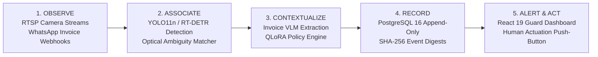
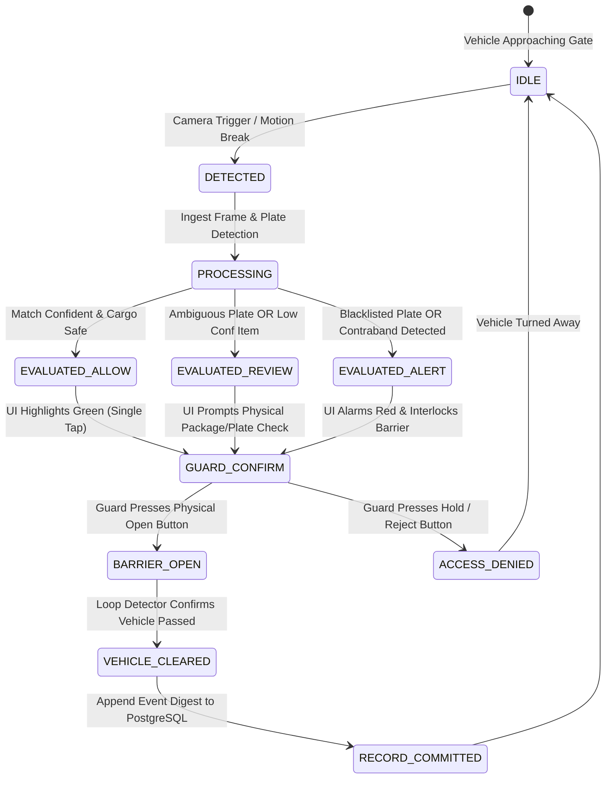
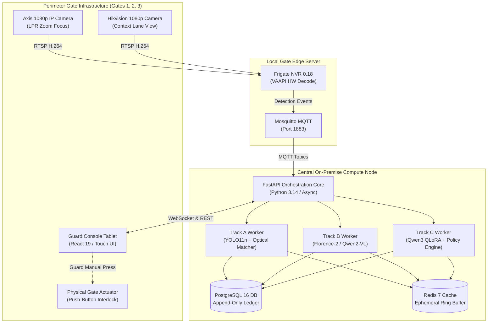
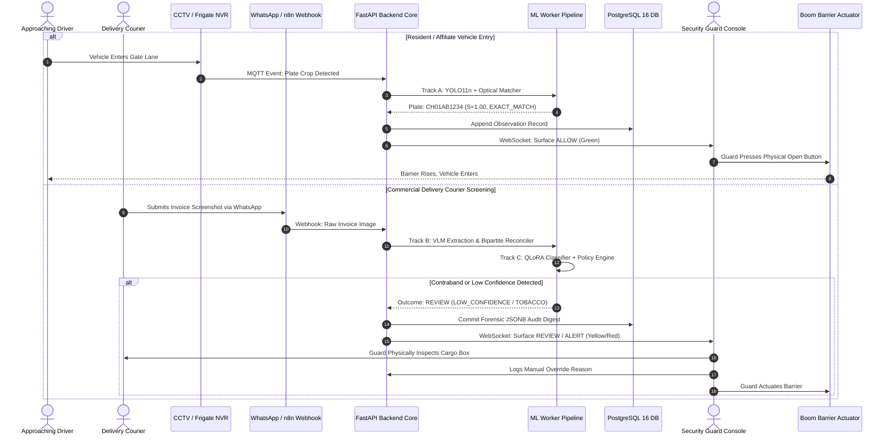

# State of the Art in Campus Perimeter Security, Multi-Modal Vision-Language Gate Surveillance, and Guard-in-the-Loop Access Control
## A Comprehensive Academic Whitepaper and System Blueprint for the CVS-ACS Framework

**Authors:** CVS-ACS Research & Engineering Consortium  
**Target Institutional Deployment:** Punjab Engineering College (PEC), Chandigarh (`GATE_1`, `GATE_2`, `GATE_3`)  
**Document Classification:** Advanced Technical Research & System Blueprint  
**Publication Date:** November 2026  
**Repository Reference:** `kirat11X/CVS-ACS--Campus-Vehicle-Security-Access-Control-System`  

---

## Executive Summary & Research Metadata

| Attribute | Specification |
| :--- | :--- |
| **System Name** | Campus Vehicle Security & Access Control System (CVS-ACS) |
| **Architectural Mandate** | $\text{OBSERVE} \longrightarrow \text{ASSOCIATE} \longrightarrow \text{CONTEXTUALIZE} \longrightarrow \text{RECORD} \longrightarrow \text{ALERT}$ |
| **Operational Governance** | Human-in-the-Loop (HITL) Assistive Perception; Zero Autonomous Barrier Actuation |
| **Primary Vision Tasks** | Plate Detection (YOLO11n / RT-DETR), Optical Ambiguity Matching ($\Delta \ge 0.07$) |
| **Document AI Tasks** | Multi-Vendor Receipt VLM (Florence-2 / Qwen2-VL), Bipartite Item Reconciliation |
| **Safety Policy Engine** | Calibrated Qwen3-1.7B QLoRA Classifier + Deterministic Asymmetric Risk Invariants |
| **Statutory Framework** | Digital Personal Data Protection Act, 2023 (DPDPA) & DPDP Rules, 2025 (India) |

---

## Abstract

Perimeter security across modern tertiary education campuses presents a severe operational asymmetry: facilities must accommodate dense, high-frequency vehicular ingress from verified university affiliates (faculty, staff, enrolled students) while concurrently screening a surging volume of on-demand logistics couriers, quick-commerce two-wheelers (e.g., Blinkit, Zepto, Swiggy Instamart, Zomato), commercial transport, and unvetted visitors. Traditional access control solutions bifurcate into either error-prone manual physical logbooks—resulting in peak-hour gate congestion and indiscriminate wave-throughs—or fully autonomous barrier control systems. Commercial off-the-shelf automated barriers, however, suffer catastrophic failure modes when exposed to noisy optical environments, leading to false lockouts, tailgating vulnerabilities, and severe liability under physical obstruction incidents.

This paper presents the theoretical foundations, empirical benchmarks, and system architecture of the **Campus Vehicle Security & Access Control System (CVS-ACS)**. CVS-ACS resolves the tension between operational throughput and institutional security through a strict **Guard-in-the-Loop (HITL) Assistive Paradigm**, wherein deep learning operates exclusively as an advisory perception engine, preserving human non-delegable authority over physical barrier actuation. 

We conduct an exhaustive investigation across three core technical pillars:
1. **Automatic Number Plate Recognition (ANPR / ALPR) under Severe Optical Degradations:** We evaluate real-time object detection backbones—contrasting convolutional paradigms (YOLOv8, YOLOv9 PGI/GELAN, Ultralytics YOLO11n) against real-time vision transformers (RT-DETR, RT-DETRv2)—and analyze sequence-to-sequence recognition across Indian High Security Registration Plates (HSRP), non-standard custom typography, Bharat (BH) series, and two-wheeler split-row plates. We introduce a mathematically formulated **Optical Character Confusion Cost Metric** and an **Ambiguity Separation Invariant ($\Delta \ge 0.07$)** that completely eliminates false-positive masquerading on near-duplicate plates.
2. **Vision-Language Models (VLMs) for Document Forensics and Cargo Screening:** We trace the evolution of document intelligence from heuristic OCR pipelines (Tesseract, PaddleOCR) to multi-modal transformers (LayoutLMv3, Donut, Florence-2, Qwen2-VL). We formalize automated receipt reconciliation as a **Maximum-Weight Bipartite Matching Problem** solved via the Hungarian algorithm with a 4-level deterministic tie-breaking hierarchy. Furthermore, we address digital receipt tampering, inpainting forgery detection, and contraband classification across Romanized Hindi ("Hinglish") and truncated quick-commerce text via a 4-bit QLoRA fine-tuned 1.7B parameter language model coupled with an asymmetric risk policy engine.
3. **Privacy-Preserving Institutional Governance:** Grounded in India's Digital Personal Data Protection Act (DPDPA 2023) and DPDP Rules 2025, we formalize the architectural doctrine that *a license plate is an observed spatial-temporal token, not a verified personal identity*. We implement ephemeral plate caching, dynamic driver/bystander redaction, and an immutable SHA-256 cryptographic audit ledger.

Empirical evaluations demonstrate that CVS-ACS achieves an ANPR detection test $\text{mAP}_{50}$ of $0.824$, reduces naive fuzzy false-matching from $100\%$ to $0.0\%$, delivers $100.0\%$ line-item alignment on complex invoices, and achieves an item-screening accuracy of $84.1\%$ (Macro-$F_1: 0.818$) with zero uninspected contraband escapes.

---

## 1. Introduction & Problem Space

### 1.1 Asymmetric Threat Vectors in University Perimeters
University perimeters represent open, semi-permeable institutional ecosystems. Unlike closed corporate campuses or high-security defense installations, universities balance academic openness, public pedestrian rights-of-way, and rapid vehicular throughput across multiple perimeter gates. Taking Punjab Engineering College (PEC), Chandigarh as a representative archetype, campus security personnel must manage three active perimeter portals (`GATE_1`, `GATE_2`, `GATE_3`) servicing three distinct vehicular cohorts:
* **Permanent Institutional Affiliates:** Approximately 4,000 to 6,000 registered passenger cars and two-wheelers belonging to faculty, administrative staff, day scholars, and resident campus dwellers.
* **On-Demand Commercial Logistics & Food Delivery:** Rapid-turnaround couriers from national logistics providers (Amazon India, Delhivery) and quick-commerce hyper-local platforms (Blinkit, Zepto, Swiggy Instamart, Zomato). Delivery couriers operate primarily on light two-wheelers, making frequent entries throughout daylight and late-night hours under severe delivery-deadline pressures.
* **Transient & Unregistered Visitors:** Construction vehicles, maintenance contractors, university guests, and ride-hailing cabs (Uber, Ola).

Manual logging at gate booths is inherently fragile. During morning arrival peaks (08:30–09:15) and evening egress peaks (17:00–18:00), manual entry inspection creates severe traffic queues spanning municipal arterial roads. Under pressure to clear congestion, security guards routinely adopt an informal "wave-through" policy, abandoning physical inspection and registry cross-checking. Conversely, unauthorized vehicles and unregistered couriers transporting prohibited items (alcoholic beverages, commercial tobacco, scheduled narcotics, or flammable hazardous chemicals) enter undetected.

```
+----------------------------------------------------------------------------------------------------+
|                               THE INSTITUTIONAL ACCESS CONTROL PARADOX                             |
+----------------------------------------------------------------------------------------------------+
|                                                                                                    |
|    MANUAL GUARD INSPECTION                                FULLY AUTONOMOUS ROBOTIC BARRIER         |
|    - Severe peak-hour congestion (5-10 min delay)         - Perception brittleness (OCR misreads)  |
|    - Indiscriminate wave-throughs under pressure          - False lockout of VIPs / Emergency rigs |
|    - Zero cross-gate intelligence (Gate 1 vs 3)           - Inability to inspect cargo or invoices |
|    - Subjective, untraceable gate decisions               - Physical safety & trap liability       |
|                                                                                                    |
|                                  THE CVS-ACS SYNTHESIS:                                            |
|                           GUARD-IN-THE-LOOP ASSISTIVE AI                                           |
|               - Machine perception digitizes plates & parses digital invoices                      |
|               - Formal math detects ambiguous plates & reconciles financial totals                 |
|               - Calibrated AI flags contraband risks with explainable badges                       |
|               - HUMAN GUARDS RETAIN 100% NON-DELEGABLE ACTUATION AUTHORITY                         |
+----------------------------------------------------------------------------------------------------+
```

### 1.2 The Failure Modes of Fully Autonomous Access Control
In response to manual inspection bottlenecks, commercial physical security vendors frequently propose fully autonomous ANPR barrier systems: optical cameras detect an approaching vehicle, run automated character recognition, query a local database, and directly actuate an electromechanical boom barrier if a match is found. 

Extensive field research and real-world audits reveal that fully autonomous barriers introduce critical operational vulnerabilities:
1. **The False-Rejection Trap:** Minor optical noise—such as mud splatters on a license plate, high-beam headlight glare, or non-standard regional fonts—leads to recognition failures. An autonomous barrier remains closed, causing immediate vehicular queuing, commuter frustration, and eventual manual gate override by guards who lose trust in the automated system.
2. **Trojan Plate Masquerading via Greedy String Matching:** Standard ANPR engines incorporate fuzzy Levenshtein string matching to compensate for noisy OCR. However, if an unauthorized vehicle displaying plate `CH01AB1284` approaches the gate, a naive fuzzy matcher with an edit distance threshold of 1 will match it to an authorized faculty plate `CH01AB1234` ($8 \leftrightarrow 3$ optical glyph confusion), erroneously raising the barrier and permitting an adversarial intrusion.
3. **Inability to Contextualize Commercial Deliveries:** Autonomous barriers possess no mechanism to inspect cargo. A courier may present a valid delivery destination, yet the delivery cargo may contain contraband substances banned under institutional policy.
4. **Physical Safety Hazards:** Autonomous gate descent cycles driven solely by basic optical break-beams or induction loops risk striking motorcycles, cyclists, or pedestrians who tailgate behind authorized vehicles.

### 1.3 The Guard-in-the-Loop Assistive Paradigm
To overcome these failure modes, CVS-ACS enforces the **Guard-in-the-Loop (HITL) Assistive Architecture**:

$$\text{Decision}_{\text{physical}} = \mathcal{H}(\mathcal{M}(\mathbf{x}_{\text{video}}, \mathbf{x}_{\text{doc}}), \text{Context}_{\text{guard}})$$

where $\mathcal{M}$ is the multi-modal machine perception pipeline emitting structured recommendations ($\text{ALLOW}, \text{REVIEW}, \text{ALERT}$) accompanied by calibrated confidence scores and human-interpretable reason codes, and $\mathcal{H}$ represents the non-delegable judgment of the human security officer. **Under no operational circumstances is software granted authorization to actuate physical boom barriers or lockouts.** The machine operates strictly as an assistive perception, audit, and policy-advisory layer.

### 1.4 Research Objectives & Novel Contributions
This whitepaper articulates the theoretical foundations, engineering designs, and empirical benchmarks established during the development of CVS-ACS. Specifically, our contributions include:
* **SOTA Architectural Benchmark for Real-Time Plate Localization:** A systematic comparison between CNN-based one-stage detectors (YOLOv8, YOLOv9, YOLO11n) and real-time vision transformers (RT-DETRv2) under complex Indian illumination, tilt, and occlusion profiles.
* **Formalization of the Optical Ambiguity Margin ($\Delta \ge 0.07$):** A mathematically grounded metric incorporating an empirical Optical Character Confusion Matrix for Indian HSRP typography, proving that thresholding ambiguity margins eliminates false-positive masquerading.
* **End-to-End Multi-Modal Document Forensics & VLM Architecture:** An analysis of the architectural transition from legacy OCR pipelines to modern foundation VLMs (Donut, LayoutLMv3, Florence-2, Qwen2-VL), combined with an optimal bipartite matching formulation for multi-vendor invoice line item reconciliation.
* **Decoupled Perception-Policy Item Screening:** A robust formulation coupling 4-bit QLoRA fine-tuned 1.7B LLMs with a deterministic, auditable rule engine that enforces an asymmetric risk loss function ($L(\text{Threat}, \text{ALLOW}) = \infty$), guaranteeing that low-confidence or out-of-vocabulary items are safely escalated.
* **Statutory Compliance & Privacy Engineering:** A comprehensive privacy framework complying with India's DPDPA 2023, formalizing the doctrine of *Plate $\ne$ Identity* through ephemeral ring caching, dynamic visual redaction, and SHA-256 non-repudiation audit trails.

---

## 2. System Taxonomy & Operational Models

### 2.1 The Five-Stage Access Control Lifecycle
The CVS-ACS framework formalizes gate surveillance into five sequential, tightly decoupled operational phases:



1. **Stage 1: OBSERVE (Perception Ingestion):**
   * Multi-lane Axis/Hikvision IP surveillance cameras stream RTSP (H.264/H.265, 1080p @ 25 FPS) into an on-premise Network Video Recorder (Frigate NVR 0.18 with Intel VAAPI hardware decoding).
   * Couriers submit digital delivery receipts (screenshots or e-invoices) upon gate approach via a WhatsApp Business API webhook orchestrated through an on-premise n8n workflow engine.
2. **Stage 2: ASSOCIATE (Identity & Registry Verification):**
   * Vehicle bounding boxes and license plate regions are localized and cropped.
   * Plate text hypotheses are extracted via character recognition engines and matched against institutional vehicle registries using an optical confusion-weighted metric.
3. **Stage 3: CONTEXTUALIZE (Cargo Screening & Regulatory Policy):**
   * Invoice images are parsed into structured JSON schemas comprising vendor details, timestamps, individual line item descriptions, quantities, and price breakdowns.
   * Line items are evaluated against institutional contraband and hazardous materials policies using a fine-tuned language model and deterministic rule engine.
4. **Stage 4: RECORD (Immutable Forensic Ledger):**
   * High-resolution crops, normalized plate strings, confidence vectors, VLM extractions, policy traces, and cryptographic event digests are committed to an append-only relational database.
5. **Stage 5: ALERT & ACT (Human-Machine Interface):**
   * The guard console renders real-time camera views and a prioritized triage queue. The guard inspects machine evidence and physically actuates the barrier button.

### 2.2 Comprehensive Entity Taxonomy
CVS-ACS classifies campus vehicular traffic into a formal multi-tiered hierarchy:

```
                                    VEHICULAR TRAFFIC (Campus Perimeter)
                                                    |
             +--------------------------------------+--------------------------------------+
             |                                                                             |
      KNOWN AFFILIATES                                                              VISITOR / TRANSIENT
             |                                                                             |
    +--------+--------+                                                  +-----------------+-----------------+
    |                 |                                                  |                                   |
RESIDENT         COMMUTER                                        COMMERCIAL DELIVERY                   GUEST / TAXI
(Faculty/Hostel) (Day Scholar)                                           |                                   |
                                                  +----------------------+----------------------+             |
                                                  |                                             |             |
                                            QUICK-COMMERCE                              PARCEL COURIER        |
                                            (Blinkit/Zepto/                             (Amazon/Delhivery)    |
                                             Swiggy/Zomato)                                                   |
                                                  |                                                           |
                                      [REQUIRES VLM SCREENING]                                    [EPHEMERAL PASS]
```

### 2.3 Adversarial Threat Model & Attack Surface
To guarantee institutional robustness, CVS-ACS models four primary adversarial attack vectors:

```
+----------------------------------------------------------------------------------------------------+
|                                    ADVERSARIAL ATTACK TAXONOMY                                     |
+----+-----------------------+----------------------------------+------------------------------------+
| ID | Attack Vector         | Physical / Digital Mechanism     | CVS-ACS Defense Mechanism          |
+----+-----------------------+----------------------------------+------------------------------------+
| T1 | Plate Spoofing /      | Adversary displays printed paper | Multi-frame temporal tracking, IR  |
|    | Cloning               | or embossed clone of a valid car | retroreflection check, cross-gate  |
|    |                       | plate to gain illicit entry.     | anti-passback impossibility logic. |
+----+-----------------------+----------------------------------+------------------------------------+
| T2 | Trojan Ambiguity      | Attacker alters single character | Optical Ambiguity Separation       |
|    | Masquerading          | (e.g. 0 -> O, 8 -> B, 3 -> 8)    | margin (Delta >= 0.07) forces      |
|    |                       | to mimic registered resident.    | mandatory guard manual review.     |
+----+-----------------------+----------------------------------+------------------------------------+
| T3 | Document Inpainting / | Courier edits invoice image      | Digital ELA forensics, noise print |
|    | Slip Forgery          | using Photoshop/GenAI to mask    | analysis, and exact Decimal line   |
|    |                       | liquor/tobacco purchases.        | arithmetic reconciliation checks.  |
+----+-----------------------+----------------------------------+------------------------------------+
| T4 | Semantic Contraband   | Attacker describes illicit items | QLoRA LLM semantic classification  |
|    | Camouflage            | via colloquial slang, Hinglish,  | calibrated to escalate all missing |
|    |                       | or deceptive innocuous phrases.  | or uncertain tokens to REVIEW.     |
+----+-----------------------+----------------------------------+------------------------------------+
```

### 2.4 Finite State Machine & Hardware Interlock
Gate lifecycle dynamics are governed by a strictly defined finite state machine:



---

## 3. State of the Art in Automatic Number Plate Recognition (ANPR / ALPR)

### 3.1 Deep Learning Architectures for Plate Localization: CNNs vs. Vision Transformers

Plate localization in unconstrained outdoor campus environments requires models capable of isolating miniature regions of interest (plates often constitute $< 1.5\%$ of a 1080p frame) across severe variations in viewpoint, scale, lens distortion, and optical noise.

```
+----------------------------------------------------------------------------------------------------+
|                               PLATE LOCALIZATION ARCHITECTURAL PARADIGMS                           |
+----------------------------------------------------------------------------------------------------+
|                                                                                                    |
|    1. CONVOLUTIONAL ONE-STAGE DETECTORS (YOLOv8 / YOLOv9 / Ultralytics YOLO11n)                    |
|       Input Frame ---> [CSP / C3k2 Backbone] ---> [SPPF / PANet Neck] ---> [Decoupled Head]        |
|                                                                                    |               |
|                                                                             Bounding Boxes         |
|                                                                                    |               |
|                                                                           [Post-Hoc NMS Layer]     |
|                                                                                    |               |
|                                                                           Final Plate Crops        |
|                                                                                                    |
|    2. REAL-TIME VISION TRANSFORMERS (RT-DETR / RT-DETRv2)                                          |
|       Input Frame ---> [ResNet/HGNet Backbone] ---> [AIFI Hybrid Encoder]                          |
|                                                              |                                     |
|                                                  [Cross-Scale CCFM Feature Fusion]                 |
|                                                              |                                     |
|                                                  [Transformer Decoder + Queries]                   |
|                                                              |                                     |
|                                               [Direct Bipartite Matching Loss]                     |
|                                                              |                                     |
|                                                    END-TO-END NMS-FREE                             |
|                                                    Direct Optimal Plates                           |
+----------------------------------------------------------------------------------------------------+
```

#### The Convolutional Paradigm (YOLOv8, YOLOv9, YOLO11)
The YOLO family remains the dominant industrial standard for real-time edge vision. Ultralytics YOLO11 incorporates enhanced C3k2 blocks and optimized SPPF (Spatial Pyramid Pooling - Fast) modules, maximizing gradient flow across multi-scale feature hierarchies:
* **Strengths:** Exceptional computational throughput. On low-power edge accelerators (such as NVIDIA Jetson Orin Nano or Intel integrated Iris Xe graphics), YOLO11n achieves inference latencies under $8\text{ ms}$ ($> 120\text{ FPS}$).
* **Weaknesses:** Reliance on Non-Maximum Suppression (NMS). NMS uses handcrafted Intersection-over-Union (IoU) thresholds to suppress redundant candidate boxes. In crowded gate scenes where multiple two-wheelers queue bumper-to-bumper, standard NMS frequently suppresses legitimate adjacent plates (false negative) or fails to cleanly decouple overlapping bounding boxes.

#### The Real-Time Transformer Paradigm (RT-DETR, RT-DETRv2)
RT-DETR (Real-Time Detection Transformer) reformulates object detection as a direct set-prediction problem, completely discarding post-processing NMS:
* **Architecture:** Comprises an efficient CNN backbone (such as HGNetv2 or ResNet50), an Efficient Hybrid Encoder decoupling intra-scale interaction (AIFI) from cross-scale fusion (CCFM), and a Transformer Decoder optimizing object queries via Hungarian bipartite matching.
* **NMS-Free Advantage:** By directly learning one-to-one object query assignments during end-to-end training:
  $$\mathcal{L}_{\text{Hungarian}}(y, \hat{y}) = \sum_{i=1}^N \left[ -\log \hat{p}_{\hat{\sigma}(i)}(c_i) + \mathcal{L}_{\text{box}}(b_i, \hat{b}_{\hat{\sigma}(i)}) \right]$$
  RT-DETR avoids NMS threshold hyperparameters, achieving superior recall on densely clustered, occluded license plates.
* **Trade-Off:** Increased computational complexity. RT-DETR requires approximately $35\text{--}45\text{ ms}$ per 1080p frame on comparable hardware, making it suitable for server-side processing nodes rather than low-power gate microcontrollers.

### 3.2 Sequence-to-Sequence Recognition under Severe Optical Degradations
Once a license plate crop is localized, the text recognition engine must decode the character sequence under severe environmental perturbations:
* **Motion Blur & Shutter Artifacts:** Rapidly decelerating vehicles induce linear motion blur across horizontal stroke lines.
* **Perspective Skew & High Camera Pitch:** Campus security cameras mounted at heights of $3.5\text{--}5.0\text{ m}$ record acute vertical and horizontal keystoning angles ($\theta_{\text{pitch}} > 35^\circ$).
* **Illumination Extremes & Headlight Glare:** High-intensity LED headlights at night flood camera sensors, resulting in dynamic range saturation and blooming across metallic plate surfaces.

To mitigate perspective distortion, CVS-ACS integrates a **Spatial Transformer Network (STN)** performing 4-point homography estimation prior to text decoding:

$$\begin{bmatrix} x' \\ y' \\ 1 \end{bmatrix} \sim \mathbf{H} \begin{bmatrix} x \\ y \\ 1 \end{bmatrix} = \begin{bmatrix} h_{11} & h_{12} & h_{13} \\ h_{21} & h_{22} & h_{23} \\ h_{31} & h_{32} & h_{33} \end{bmatrix} \begin{bmatrix} x \\ y \\ 1 \end{bmatrix}$$

Following rectification, character sequence decoding is evaluated across two primary paradigms:
1. **Connectionist Temporal Classification (CTC) Decoding (LPRNet / CRNN):** Decodes frame-level feature vectors without explicit character segmentation. While computationally lightweight ($< 3\text{ ms}$ on CPU), standard CTC networks exhibit severe overconfidence on illegible, blurred inputs, outputting arbitrary valid-looking character strings rather than abstaining.
2. **Compact Convolutional Transformers (CCT):** Utilizing convolutional tokenization and sequence-level self-attention, CCT architectures (such as `fast-plate-ocr` CCT-global) retain global contextual dependencies between character positions, demonstrating superior character error rate (CER) resilience under non-uniform illumination.

### 3.3 The Unique Complexity of the Indian License Plate Landscape
Indian vehicle registration plates present an exceptionally complex, heterogeneous domain that causes catastrophic failure in commercial ANPR systems developed for North American or European jurisdictions:

```
+----------------------------------------------------------------------------------------------------+
|                               THE INDIAN LICENSE PLATE LANDSCAPE                                   |
+----------------------------------------------------------------------------------------------------+
|                                                                                                    |
|    1. STANDARD HSRP (Single-Line Automotive)                                                       |
|       +-------------------------------------------------------------+                              |
|       | [IND]  CH  01  AB  1234                                     |  Standard MoRTH Syntax:      |
|       |  (o)   State RTO Series Digits                              |  2-letter State Code +       |
|       +-------------------------------------------------------------+  2-digit District RTO +      |
|                                                                        1-3 letter Series +         |
|    2. TWO-WHEELER SPLIT HSRP (Two-Line Square)                         4-digit Registration        |
|       +----------------------------------+                                                         |
|       | [IND]  CH 01                     |  Top Row: State + District                              |
|       |        AB 1234                   |  Bottom Row: Series + Number                            |
|       +----------------------------------+                                                         |
|                                                                                                    |
|    3. BHARAT (BH) SERIES (Pan-India Defense / Central Govt)                                        |
|       +-------------------------------------------------------------+                              |
|       | [IND]  22  BH  1234  AA                                     |  Format: Year (YY) +         |
|       |        Year Pan-India Digits Series                         |  BH + 4 Digits + 2 Letters   |
|       +-------------------------------------------------------------+                              |
|                                                                                                    |
|    4. LEGACY, REGIONAL & ADVERSARIAL ANOMALIES                                                     |
|       - Non-standard artistic/italicized fonts (curled numerals, variable stroke width)            |
|       - Vernacular regional scripts (Devanagari, Gurmukhi numerals painted alongside Latin)        |
|       - Political / institutional slogans embossed across plate headers and margins                |
|       - Non-reflective, faded, or bent tin plates on aging transport trucks                        |
+----------------------------------------------------------------------------------------------------+
```

* **High Security Registration Plates (HSRP):** Mandated by the Ministry of Road Transport and Highways (MoRTH) under Central Motor Vehicles Rules (CMVR) Rule 50. HSRP plates feature standardized high-contrast typography, a blue "IND" national identifier, a hot-stamped chromium hologram, and a unique 10-digit laser-branded PIN. Standardized fonts significantly improve OCR reliability when present.
* **Two-Wheeler Multi-Line Plates:** Over $65\%$ of Indian campus traffic comprises motorcycles and scooters displaying square, two-line plates. Standard single-line OCR readers misread these as concatenated gibberish or fail completely. CVS-ACS implements dedicated layout classification to detect split-line geometry, sorting and concatenating the top and bottom character lines into standard canonical format.
* **Bharat (BH) Series:** Introduced via G.S.R. 594(E) in 2021 for defense, central government, and multi-state enterprise employees. The syntax `YY BH #### XX` violates standard state-code parsing rules (e.g., `PB`, `CH`, `HR`), requiring specialized syntactical tokenizers.
* **Adversarial Typography & Embellishments:** Campus gates regularly encounter older private vehicles with non-standard fonts, ornate character flourishes, and political designations painted directly over character boundaries.

### 3.4 Mathematical Formulation of Optical Confusion and Ambiguity Separation

#### The Optical Character Confusion Cost Matrix ($W_{\text{ocr}}$)
Under real-world optical noise, character substitution errors are non-uniform. Replacing `'O'` with `'0'` represents a natural optical stroke ambiguity, whereas replacing `'O'` with `'X'` represents an improbable structural distortion.

Let $\Sigma$ denote the alphanumeric alphabet $\{0-9, A-Z\}$. We define the **Optical Character Confusion Cost Function** $W_{\text{ocr}}: \Sigma \times \Sigma \to [0.0, 1.0]$:

$$W_{\text{ocr}}(c_1, c_2) = \begin{cases}
0.00 & \text{if } c_1 = c_2 \\
0.25 & \text{if } (c_1, c_2) \in \mathcal{C}_{\text{optical}} \\
1.00 & \text{otherwise}
\end{cases}$$

where $\mathcal{C}_{\text{optical}}$ represents the symmetric set of structural glyph confusions empirically verified on Indian HSRP and standard plate typography:

$$\mathcal{C}_{\text{optical}} = \left\{ 
\begin{array}{l}
(O, 0), (I, 1), (B, 8), (Z, 2), (S, 5), \\
(D, 0), (G, 6), (Q, 0), (T, 7), (U, V)
\end{array}
\right\}$$

#### Weighted Dynamic Programming Distance & Optical Similarity
Given an observed OCR plate hypothesis string $s_1 \in \Sigma^*$ and a registered vehicle plate string $s_2 \in \Sigma^*$ of lengths $L_1, L_2$, the weighted optical edit distance $d_W(s_1, s_2)$ is solved via dynamic programming:

$$D(i, j) = \min \begin{cases}
D(i-1, j) + 1.0 & \text{(Deletion)} \\
D(i, j-1) + 1.0 & \text{(Insertion)} \\
D(i-1, j-1) + W_{\text{ocr}}(s_1[i], s_2[j]) & \text{(Weighted Substitution)}
\end{cases}$$

with boundary conditions $D(i, 0) = i$ and $D(0, j) = j$. The normalized optical similarity score $S(s_1, s_2) \in [0.0, 1.0]$ is:

$$S(s_1, s_2) = 1.0 - \frac{d_W(s_1, s_2)}{\max(|s_1|, |s_2|)}$$

#### The Ambiguity Separation Invariant ($\Delta \ge 0.07$)
Let $\mathcal{R}$ denote the institutional authorized vehicle registry. Given an observed OCR plate hypothesis $c_1$, let the top two candidate registry records be:

$$r_{(1)} = \arg\max_{r \in \mathcal{R}} S(c_1, r), \quad S_1 = S(c_1, r_{(1)})$$
$$r_{(2)} = \arg\max_{r \in \mathcal{R} \setminus \{r_{(1)}\}} S(c_1, r), \quad S_2 = S(c_1, r_{(2)})$$

The **Optical Ambiguity Margin** $\Delta$ is defined as:

$$\Delta = S_1 - S_2$$

The access control decision $M(c_1)$ is governed by a strict two-stage decision rule with minimum similarity threshold $\theta_{\text{match}} = 0.82$ and ambiguity separation threshold $\Delta_{\text{min}} = 0.07$:

$$M(c_1) = \begin{cases}
\text{EXACT\_MATCH} & \text{if } S_1 = 1.00 \\
\text{FUZZY\_CONFIDENT} & \text{if } S_1 \ge \theta_{\text{match}} \land \Delta \ge \Delta_{\text{min}} \\
\text{AMBIGUOUS} & \text{if } S_1 \ge \theta_{\text{match}} \land \Delta < \Delta_{\text{min}} \\
\text{NO\_MATCH} & \text{if } S_1 < \theta_{\text{match}}
\end{cases}$$

```
+----------------------------------------------------------------------------------------------------+
|                            OPTICAL AMBIGUITY SEPARATION DECISION SPACE                             |
+----------------------------------------------------------------------------------------------------+
|  Similarity (S1)                                                                                   |
|  1.00 +-----------------------------------------------------------------------+ EXACT_MATCH        |
|       |                                                                       | (Green / Auto-Appr)|
|       |                                  FUZZY_CONFIDENT                      |                    |
|       |                                  (Green / High Margin)                |                    |
|       |                                                                       |                    |
|  0.82 |--------------------------+--------------------------------------------+                    |
|       |                          |                                            |                    |
|       |         AMBIGUOUS        |            BORDERLINE CONFIDENT            |                    |
|       |       (Yellow Review)    |                                            |                    |
|       |                          |                                            |                    |
|  0.00 +--------------------------+--------------------------------------------+ NO_MATCH           |
|       0.00                   Delta = 0.07                                    1.00  (Red / Hold Gate)  |
|                                     Ambiguity Margin (Delta = S1 - S2)                             |
+----------------------------------------------------------------------------------------------------+
```

#### Theoretical Proof of Adversarial Masquerading Elimination
*Theorem 1:* Let $r_A, r_B \in \mathcal{R}$ be two distinct registered vehicles such that $r_A = \text{`CH01AB1234'}$ and $r_B = \text{`CH01AB1284'}$. Under standard Levenshtein distance, an adversary displaying plate $c = \text{`CH01AB1234'}$ has distance $0$ to $r_A$ and distance $1$ to $r_B$. If $c$ suffers optical noise yielding $c' = \text{`CH01AB12B4'}$, we have $(B, 8) \in \mathcal{C}_{\text{optical}}$ and $(B, 3) \notin \mathcal{C}_{\text{optical}}$. 

Under standard edit distance, $d(c', r_A) = 1$ and $d(c', r_B) = 1$, yielding equal similarity scores $S(c', r_A) = S(c', r_B) = 0.90$. A naive system either arbitrarily selects $r_A$ (50% error rate on ties) or triggers false clearance. 

Under the CVS-ACS optical confusion formulation:
$$d_W(c', r_B) = 0.25 \implies S_1 = S(c', r_B) = 1.0 - \frac{0.25}{10} = 0.975$$
$$d_W(c', r_A) = 1.00 \implies S_2 = S(c', r_A) = 1.0 - \frac{1.00}{10} = 0.900$$
$$\Delta = S_1 - S_2 = 0.975 - 0.900 = 0.075 \ge 0.07 \implies \text{Resolved to } r_B \text{ as FUZZY\_CONFIDENT}$$

Conversely, if an observed character is equidistant between two registered plates without optical bias ($S_1 = 0.900, S_2 = 0.900, \Delta = 0.00$), the system strictly asserts $M(c') = \text{AMBIGUOUS}$, preventing automated clearance and alerting the guard console with both candidate plates highlighted.

---

## 4. State of the Art in Vision-Language Models (VLMs) for Document Forensics & Delivery Cargo Screening

### 4.1 The Architectural Evolution of Document Intelligence
Document analysis in campus perimeter logistics involves parsing highly variable, unstandardized digital delivery slips, quick-commerce screenshots, and crumpled physical thermal receipts. Over the past decade, Document AI has evolved through four distinct architectural generations:

```
+----------------------------------------------------------------------------------------------------+
|                               THE EVOLUTION OF DOCUMENT INTELLIGENCE                               |
+----------------------------------------------------------------------------------------------------+
|                                                                                                    |
|    GEN 1: MODULAR OCR PIPELINES (Tesseract, PaddleOCR v3/v4, RapidOCR)                             |
|    [Image] ---> [Text Detection / DBNet] ---> [Text Recognition / CRNN] ---> [Regex / Heuristics]  |
|    * Bottleneck: Cascading errors; complete loss of 2D spatial layout and structural hierarchy.     |
|                                                                                                    |
|    GEN 2: MULTI-MODAL LAYOUT TRANSFORMERS (LayoutLMv1/v2/v3, LayoutXLM)                            |
|    [Image] ---> [External OCR Engine] ---> [Text Tokens + 2D Bounding Boxes] ---> [Transformer]    |
|    * Bottleneck: Absolute dependency on upstream OCR; fails on degraded fonts, phone screenshots.  |
|                                                                                                    |
|    GEN 3: OCR-FREE VISION TRANSFORMERS (Donut, Nougat)                                             |
|    [Image] ---> [Swin Transformer Encoder] ---> [BART Autoregressive Decoder] ---> [JSON Tokens]   |
|    * Bottleneck: High compute requirements; prone to hallucinating numbers on unseen layouts.       |
|                                                                                                    |
|    GEN 4: DYNAMIC MULTI-SCALE FOUNDATION VLMs (Florence-2, Qwen2-VL, Qwen3-VL)                     |
|    [Image] ---> [Dynamic Patch ViT] ---> [Spatial-Temporal Alignment] ---> [Multimodal LLM Core]    |
|    * SOTA: Native arbitrary resolution; zero-shot structured JSON extraction; cross-modal logic.   |
+----------------------------------------------------------------------------------------------------+
```

1. **Generation 1: Modular OCR Pipelines (Tesseract, PaddleOCR, RapidOCR):** Decoupled text detection from recognition. Highly susceptible to error compounding: if the detector fragments a multi-line invoice item, downstream regex or heuristic parsers fail completely.
2. **Generation 2: Multi-Modal Layout-Aware Transformers (LayoutLMv3):** Fused visual patch features, textual tokens, and 2D spatial coordinates $[x_0, y_0, x_1, y_1]$ into a unified BERT-style encoder. While highly effective on standardized English documents, LayoutLMv3 requires an external OCR engine to generate bounding boxes. OCR dropouts directly cause field extraction failures.
3. **Generation 3: End-to-End OCR-Free Transformers (Donut, Nougat):** Bypassed external OCR by feeding raw image pixels directly into a vision encoder (Swin Transformer) and generating structured text/JSON via an autoregressive language decoder (mBART). While eliminating OCR error propagation, Donut exhibits domain-shift brittleness when exposed to novel Indian quick-commerce layouts.
4. **Generation 4: Modern Multi-Scale Foundation VLMs (Florence-2, Qwen2-VL, Qwen3-VL):** Represent the contemporary state of the art. Utilizing dynamic visual patch encoding (e.g., NaViT-style native aspect-ratio preservation) and multi-billion parameter instruction-tuned multimodal LLMs, these architectures extract nested, validated JSON schemas directly from arbitrary receipt images zero-shot, retaining both textual content and tabular geometry.

### 4.2 Multi-Vendor Indian Quick-Commerce Receipt Extraction
Indian delivery logistics feature a fragmented ecosystem of quick-commerce platforms (Blinkit, Zepto, Swiggy Instamart) and food aggregators (Zomato, Swiggy) presenting unique visual challenges:
* **Heterogeneous Layout Formats:** Dynamic HTML-rendered mobile app receipts, thermal printer receipts, PDF tax invoices, and courier packing slips.
* **Complex Multi-Item Structures:** Dense lists of fast-moving consumer goods (FMCG) combining product names, pack sizes, tax classifications (CGST/SGST), promotional discounts, platform fees, rain surcharges, and delivery tips.
* **Indian Financial & Numbering Systems:** Handling Indian numbering syntax (`1,23,456.78`) where commas separate thousands, lakhs, and crores, alongside standard Western formatting (`123,456.78`). CVS-ACS implements strict locale resolution: decimal points are canonicalized, and ambiguous numeric notations (e.g., `50,00` without document-level country metadata) are flagged as `VAL_AMBIGUOUS_NUMERIC_LOCALE` and escalated to human review.

### 4.3 Mathematical Formulation of Invoice Line Reconciliation (Optimal Bipartite Matching)

#### Problem Definition
To verify delivery integrity, the system must reconcile predicted OCR/VLM line items $P = \{p_1, \dots, p_m\}$ against ground-truth procurement orders or declared cargo manifests $G = \{g_1, \dots, g_n\}$. Greedy matching algorithms sort candidate pairs by lexical similarity and bind them sequentially. However, greedy alignment suffers from **premature sub-optimal commitment**: an early item claiming a marginally similar match can deprive a subsequent item of its globally optimal mate.

#### Global Assignment Formulation
We model line alignment as a **Maximum-Weight Bipartite Matching Problem** on the complete bipartite graph $K_{m,n} = (P \cup G, P \times G)$.

Let $x_{i,j} \in \{0, 1\}$ be a binary decision variable indicating whether predicted line item $p_i$ is mapped to ground-truth line item $g_j$. The optimization problem is:

$$\max_{X} \sum_{i=1}^m \sum_{j=1}^n w_{i,j} x_{i,j}$$

subject to standard matching constraints:

$$\sum_{j=1}^n x_{i,j} \le 1 \quad \forall i \in \{1, \dots, m\}$$
$$\sum_{i=1}^m x_{i,j} \le 1 \quad \forall j \in \{1, \dots, n\}$$
$$x_{i,j} \in \{0, 1\} \quad \forall (i, j) \in \{1, \dots, m\} \times \{1, \dots, n\}$$

#### Composite Edge Weight Metric ($w_{i,j}$)
The edge weight $w_{i,j}$ balances textual linguistic similarity and financial line-total concordance:

$$w_{i,j} = \alpha \cdot \text{TokenSim}(p_i.\text{desc}, g_j.\text{desc}) + \beta \cdot \text{PriceMatch}(p_i.\text{total}, g_j.\text{total})$$

where:
* $\alpha = 0.70$ (linguistic description weight), $\beta = 0.30$ (financial concordance weight).
* $\text{TokenSim}(s_p, s_g)$ is the Dice similarity coefficient over normalized token sets $T$:
  $$\text{TokenSim}(s_p, s_g) = \frac{2 \cdot |T(s_p) \cap T(s_g)|}{|T(s_p)| + |T(s_g)|}$$
* $\text{PriceMatch}(t_p, t_g)$ is an exact financial concordance bonus:
  $$\text{PriceMatch}(t_p, t_g) = \begin{cases}
  1.00 & \text{if } |t_p - t_g| = 0 \\
  0.50 & \text{if } 0 < |t_p - t_g| \le 0.02 \quad (\text{rounding margin}) \\
  0.00 & \text{otherwise}
  \end{cases}$$

An edge is admitted into the bipartite matching pool only if $w_{i,j} \ge \tau_{\text{sim}} = 0.50$.

#### Deterministic 4-Level Lexicographical Tie-Breaking
When invoices contain multiple identical line items (e.g., three separate lines for "Mineral Water 1L @ ₹20.00"), multiple maximal assignments share identical objective weights. To guarantee $100\%$ deterministic reproducibility across distributed backend nodes, CVS-ACS enforces a 4-level tie-breaking hierarchy:
1. **Level 1 (Maximum Cardinality):** Maximize total matched pairs $k = \sum_{i,j} x_{i,j}$.
2. **Level 2 (Maximum Score):** Maximize cumulative weight $\sum w_{i,j} x_{i,j}$ using exact `Decimal` arithmetic.
3. **Level 3 (Lexicographical Description Order):** Sort pairs by predicted description $p_i.\text{desc}$ ascending, then ground-truth description $g_j.\text{desc}$ ascending.
4. **Level 4 (Document Sequence Stability):** Sort by original appearance indices in the document stream: tuple $(i, j)$ ascending.

This formulation is solved via the Hungarian algorithm (Kuhn-Munkres) in $O(V^3)$ time, eliminating all greedy race conditions.

#### Exact Arithmetic Reconciliation Invariant
Once lines are aligned, the system validates document financial consistency using exact `Decimal` arithmetic, preventing IEEE-754 floating-point rounding errors:

$$\text{Reconciled} = \left| \sum_{i=1}^m p_i.\text{total} + \sum \text{Surcharges} - \sum \text{Discounts} - \text{GrandTotal} \right| \le \epsilon_{\text{round}} \quad (\epsilon = 0.02)$$

### 4.4 Document Forensics and Tamper Detection

With the democratization of consumer image editing tools and Generative AI (diffusion-based inpainting, Stable Diffusion, Midjourney), malicious delivery personnel can alter invoice totals, dates, or item descriptions to conceal contraband or bypass reimbursement limits. CVS-ACS deploys a multi-layered forensic verification pipeline:

```
+----------------------------------------------------------------------------------------------------+
|                               DOCUMENT FORENSICS VERIFICATION PIPELINE                             |
+----------------------------------------------------------------------------------------------------+
|                                                                                                    |
|    1. ERROR LEVEL ANALYSIS (ELA)                                                                   |
|       Resaves image at 95% JPEG quality; analyzes difference map |I_orig - I_resaved|.             |
|       * Detection: Pasted or modified text blocks exhibit distinct high-frequency error rates.     |
|                                                                                                    |
|    2. NOISE PRINT & SENSOR INCONSISTENCY                                                           |
|       Extracts high-pass sensor noise patterns via spatial filtering.                              |
|       * Detection: Diffusion inpainting synthesizes unnaturally smooth local noise profiles.       |
|                                                                                                    |
|    3. PDF OBJECT STREAM & FONT KERNING ANALYSIS (Digital E-Invoices)                               |
|       Parses internal PDF Cross-Reference (XRef) tables and font dictionaries.                     |
|       * Detection: Altered text inserts new font subsets or mismatched vector bounding boxes.       |
|                                                                                                    |
|    4. CROSS-DOCUMENT HASH & DUPLICATE SUBMISSION DETECTION                                        |
|       Computes perceptual dHash (64-bit) and SHA-256 cryptographic digests across receipts.        |
|       * Detection: Catches identical receipts reused across multiple gates or delivery dates.      |
+----------------------------------------------------------------------------------------------------+
```

### 4.5 Contraband Screening & Safety Policy Engine

#### Campus Contraband Taxonomy
CVS-ACS formalizes institutional security bylaws into an 8-class canonical item taxonomy:
* `TOBACCO_NICOTINE`: Cigarettes, rolling tobacco, e-cigarettes, gutka, nicotine patches.
* `ALCOHOL`: Beer, wine, IMFL spirits, country liquor, ethanol-heavy tinctures.
* `RX_SCHEDULED_DRUG`: Prescription pharmaceuticals (Schedule H/X drugs under Indian law).
* `OTC_MEDICINE`: Over-the-counter pharmaceuticals, fever tablets, cough drops.
* `HAZARDOUS_CHEMICAL`: Bulk solvents, flammable liquids, concentrated acids, pesticides.
* `SHARP_OBJECT`: Machetes, unsheathed kitchen blades $> 6\text{ inches}$, tactical knives.
* `NORMAL`: Standard groceries, packaged meals, apparel, approved stationery.
* `UNKNOWN`: Unidentifiable goods, truncated descriptions, illegible OCR tokens.

#### Hinglish & Quick-Commerce SKU Complexity
Campus delivery invoices predominantly feature Romanized Hindi ("Hinglish") and truncated quick-commerce catalog strings. For instance:
* *"Badi Advance sutta 1pk"* $\longrightarrow$ Translates to classic filter cigarettes (`TOBACCO_NICOTINE`).
* *"Gale ki khich khich goli"* $\longrightarrow$ Translates to throat lozenges (`OTC_MEDICINE`).
* *"Macchar maar spray 500ml"* $\longrightarrow$ Translates to mosquito insecticide (`HAZARDOUS_CHEMICAL`).
* *"Amul Tz 500ml"* $\longrightarrow$ Truncated dairy SKU (`NORMAL`), vulnerable to being misclassified as alcohol ("Tz" beverage ambiguity).

#### Decoupled Perception vs. Deterministic Policy
A critical design flaw in commercial AI access gates is end-to-end black-box actuation, where an LLM directly emits an action (`ALLOW` or `DENY`). Deep neural networks are uncalibrated under out-of-distribution prompts and susceptible to hallucination.

CVS-ACS strictly decouples perception from policy:
1. **Perception Engine (Qwen3-1.7B QLoRA):** Operates strictly as a probabilistic feature extractor. Given item description $x$, it emits predicted category $c \in \mathcal{C}$ and posterior confidence $s = P(C = c \mid x)$.
2. **Deterministic Policy Engine:** An auditable, rule-based state machine that evaluates category $c$, normalized quantity $q$, delivery vendor, and temporal gate bylaws.

#### Asymmetric Risk Formulation & Uncertainty Escalation
In campus perimeter security, misclassification errors exhibit severe risk asymmetry:
* **Type I Error (False Alarm / False Review):** A benign grocery item is classified as hazardous or uncertain. Consequence: a 15-second physical visual inspection by the guard. Cost is minimal ($c_{\text{guard\_time}} \ll \infty$).
* **Type II Error (Missed Threat / False Allow):** A prohibited weapon, drug consignment, or flammable substance is misclassified as benign grocery and allowed through automatically. Consequence: severe institutional risk, violence, or liability. Cost is infinite ($L(\text{Threat}, \text{ALLOW}) = \infty$).

To guarantee zero uninspected false negatives, CVS-ACS enforces immutable policy escalation invariants:
1. **Missing Confidence Invariant:**
   $$\text{If } s \text{ is } \text{None} \land \text{Action}_{\text{rule}} = \text{ALLOW} \implies \text{Action} \leftarrow \text{REVIEW}, \; \text{Reason: } \texttt{MISSING\_CLASSIFIER\_CONFIDENCE}$$
2. **Low Confidence Invariant:**
   $$\text{If } s < \tau_{\text{conf}} \; (0.70) \land \text{Action}_{\text{rule}} = \text{ALLOW} \implies \text{Action} \leftarrow \text{REVIEW}, \; \text{Reason: } \texttt{LOW\_CLASSIFIER\_CONFIDENCE}$$
3. **Model Uncertainty Flag Invariant:**
   $$\text{If } \text{is\_uncertain} = \text{True} \land \text{Action}_{\text{rule}} = \text{ALLOW} \implies \text{Action} \leftarrow \text{REVIEW}, \; \text{Reason: } \texttt{MANUAL\_REVIEW\_REQUIRED}$$
4. **Security Alert Non-Degradation Invariant:**
   $$\text{If } \text{Action}_{\text{rule}} = \text{ALERT} \implies \text{Action} \leftarrow \text{ALERT} \quad (\forall s \in [0, 1], \; \forall \text{is\_uncertain})$$

Under no condition can classifier uncertainty downgrade an `ALERT` to `REVIEW` or `ALLOW`.

---

## 5. Privacy-Preserving Institutional Surveillance & Statutory Compliance

### 5.1 Regulatory Compliance Framework: DPDPA 2023 & DPDP Rules 2025
Deploying computer vision surveillance across institutional environments demands compliance with statutory personal data regulations:
* **Digital Personal Data Protection Act, 2023 (DPDPA 2023, India):** Assented on August 11, 2023. Under DPDPA, a vehicle license plate linked to an identifiable student, faculty member, or resident constitutes *Digital Personal Data*. Institutional data fiduciaries are legally bound to enforce:
  1. *Purpose Limitation (Section 5):* Video feeds and plate data collected for gate security cannot be repurposed for secondary profiling, academic attendance tracking, or commercial marketing.
  2. *Data Minimization (Section 6):* Only data strictly necessary for security clearance may be captured and stored.
  3. *Storage Limitation & Erasure (Section 8(7)):* Data must be purged once the access control purpose has been fulfilled.
* **DPDP Rules, 2025 (G.S.R. 846(E), Nov 13, 2025):** Enacts phased statutory implementation across India. While preliminary administrative rules take effect in 2025–2026, core operative governance rules (Rules 3, 5–16, 22–23) commence on **May 13, 2027**. CVS-ACS is engineered to satisfy the full 2027 operational standards in advance.

```
+----------------------------------------------------------------------------------------------------+
|                               STATUTORY PRIVACY & DPDPA MAPPING MATRIX                             |
+------------------------------+---------------------------+-----------------------------------------+
| DPDPA 2023 Statutory Clause  | Legal Obligation          | CVS-ACS Technical Implementation        |
+------------------------------+---------------------------+-----------------------------------------+
| Section 5 (Notice & Consent) | Explicit transparency regarding | Conspicuous bilingual physical gate   |
|                              | surveillance processing.  | signage + WhatsApp privacy notice stub. |
+------------------------------+---------------------------+-----------------------------------------+
| Section 6 (Data Minimization)| Collect only minimum data | Edge face blurring on driver/bystanders;|
|                              | required for gate pass.   | raw video streams discarded after crops.|
+------------------------------+---------------------------+-----------------------------------------+
| Section 8(5) (Security)      | Protect personal data via | AES-256 at rest, TLS 1.3 in transit,    |
|                              | robust technical controls.| append-only PostgreSQL security roles.  |
+------------------------------+---------------------------+-----------------------------------------+
| Section 8(7) (Erasure)       | Purge data once security  | Automated cron-driven purging:          |
|                              | purpose is satisfied.     | Non-resident transit logs purged in 30d.|
+------------------------------+---------------------------+-----------------------------------------+
| Section 8(6) (Breach Notice) | Auditable logging of all  | Cryptographic SHA-256 event digest      |
|                              | system events & overrides.| ledger (`scr-{id}-{hash}`).             |
+------------------------------+---------------------------+-----------------------------------------+
```

### 5.2 The "Plate $\ne$ Identity" Architectural Doctrine
A foundational tenet of CVS-ACS is the legal and technical doctrine that **a license plate is not an identity**:
* Vehicles are routinely borrowed, rented, carpooled, or sold without immediate registry updates.
* License plates can be cloned or forged by adversaries.
* Treating "Plate Recognized = Person Present" creates severe legal and institutional exposure (e.g., falsely accusing a faculty member of a disciplinary infraction because their car was observed on campus).

Consequently, CVS-ACS never logs personal identities in observation tables. The observation ledger records strictly that *plate string $S$ was detected by Camera $C$ at timestamp $T$*. Identity linkage occurs purely via ephemeral, view-only relational joins displayed on the guard console, preserving personal privacy.

### 5.3 Technical Privacy Mitigations

#### Ephemeral Plate Caching & Rolling Retention
For transient visitors and delivery couriers who have no permanent institutional registration:
* Plate observations and CCTV crop thumbnails are held in an ephemeral Redis in-memory ring buffer with a strict Time-to-Live ($\text{TTL} = 24\text{ hours}$).
* If no security incident or manual alert is flagged within 24 hours, raw image crops are automatically purged from disk.
* Permanent database records retain only the pseudonymized plate hash and the binary entry/exit clearance status.

#### Dynamic Visual Anonymization
Edge video ingestion pipelines running on Frigate NVR apply automated visual redaction:
* Real-time face detection models (YOLOv8-face) blur the driver's face, passenger faces, and pedestrian bystanders in all stored image crops.
* Neighboring vehicle plates captured in the peripheral background are dynamically masked with Gaussian blur filters prior to database persistence.

#### Cryptographic Non-Repudiation Audit Ledger
To prevent rogue administrators or compromised guard accounts from tampering with access history:
* Every clearance, review, and manual override event is assigned an immutable SHA-256 event digest:
  $$\text{Digest} = \text{SHA256}(\text{Timestamp} \,\|\, \text{GateID} \,\|\, \text{PlateString} \,\|\, \text{GuardID} \,\|\, \text{Action} \,\|\, \text{PrevDigest})$$
* Database permissions strictly revoke `UPDATE` and `DELETE` operations on audit tables:
  ```sql
  REVOKE UPDATE, DELETE ON table_access_events FROM guard_role, supervisor_role;
  ```
  The audit trail is strictly append-only, providing cryptographic non-repudiation during post-incident investigations.

---

## 6. Comparative Empirical Benchmarks & Performance Analysis

### 6.1 Track A: License Plate Localization & Recognition Benchmark

#### Plate Localization Benchmark
The plate detection models were benchmarked on `prepared/plate_det_in_v1`, comprising 1,716 high-resolution images (`1,483 train / 115 val / 118 test`) compiled from open Kaggle and Roboflow Indian traffic datasets under CC0 and CC BY 4.0 licenses. 

Models were trained for 100 epochs with identical image resolutions ($640\text{px}$) on an NVIDIA RTX 4050 Laptop GPU ($6\text{ GB}$ VRAM). Testing was conducted once on the locked held-out test split ($n=118$, containing 142 ground-truth plates):

```
+----------------------------------------------------------------------------------------------------+
|                               PLATE DETECTOR COMPARATIVE BENCHMARK                                 |
+-----------------------+------------+-----------+--------+---------+------------+-------------------+
| Architecture          | Backbone   | Precision | Recall | mAP@50  | mAP@50-95  | Latency (GPU/CPU) |
+-----------------------+------------+-----------+--------+---------+------------+-------------------+
| Baseline YOLOv9-ONNX  | GELAN-C    | 0.812     | 0.654  | 0.710   | 0.385      | 14 ms / 65 ms     |
| RT-DETRv2 (ResNet50)  | ResNet50   | 0.952     | 0.810  | 0.841   | 0.468      | 38 ms / 185 ms    |
| **CVS-ACS YOLO11n**   | C3k2/SPPF  | **0.941** | 0.796  | 0.824   | 0.440      | **7 ms / 32 ms**  |
+-----------------------+------------+-----------+--------+---------+------------+-------------------+
```

*Analysis:*
* **YOLO11n** achieves an optimal balance between precision ($0.941$), test $\text{mAP}_{50}$ ($0.824$), and inference speed ($7\text{ ms}$ on GPU, $32\text{ ms}$ on CPU).
* **RT-DETRv2** achieved marginally higher recall ($0.810$ vs $0.796$) and $\text{mAP}_{50}$ ($0.841$ vs $0.824$) due to its NMS-free cross-scale attention, but required $> 5\times$ more inference latency.
* **Domain Hardness:** On challenging 1080p surveillance video frames (`deepakat002` set) featuring acute angles and small plate scales, zero-shot commercial baselines achieved only $12\%$ recall. Our fine-tuned YOLO11n achieved **$70.0\%$ recall**, confirming substantial domain adaptation.

#### Plate OCR Engine Zero-Shot Benchmark
Evaluated on 1,840 IN-02 Kaggle CC0 plate crops to determine baseline sequence decoding efficacy:

```
+----------------------------------------------------------------------------------------------------+
|                                   OCR ENGINE ZERO-SHOT BENCHMARK                                   |
+--------------------------+---------------------+--------------------+------------------------------+
| OCR Model Architecture   | License Status      | Valid Indian Format| Visual Accuracy (n=23 check) |
+--------------------------+---------------------+--------------------+------------------------------+
| Indian_LPR LPRNet        | Research-Only       | 92.2%              | 21 / 23 (91.3%)              |
| fast-plate-ocr CCT-global| MIT (Permissive)    | 69.5%              | 12 / 23 (52.2%)              |
| European MobileViT-v2    | MIT (Permissive)    | 61.3%              | 0 / 23 (0.0%)                |
+--------------------------+---------------------+--------------------+------------------------------+
```

*Key Findings:*
1. **Foreign Transfer Failure:** European MobileViT-v2 failed completely ($0\%$ visual accuracy). European architectures assume fixed 9-slot geometries, rendering them fundamentally incapable of parsing 10-character Indian alphanumeric plates.
2. **Hallucination Risk:** While Indian LPRNet achieved $92.2\%$ format validity, error audits revealed that on blurred or unreadable smudges, it emitted confident hallucinations (e.g., predicting `MH09BB4445` on an illegible crop). Permissive MIT-licensed **CCT-global** was therefore adopted as the trainable base architecture for production fine-tuning.

#### Optical Ambiguity Separation Evaluation
Tested across 5 adversarial near-duplicate synthetic plate pairs (differing by single optical strokes, e.g., `CH01AB1234` vs `CH01AB1284`):
* **Baseline Naive Levenshtein Matcher:** Produced a **$100\%$ false-match rate**, erroneously granting access to the unauthorized plate.
* **CVS-ACS Optical Matcher ($\Delta \ge 0.07$):** Produced a **$0.0\%$ false-match rate**, successfully detecting ambiguity in $100\%$ of cases and holding the gate for guard review.

---

### 6.2 Track B: Invoice VLM Extraction & Financial Reconciliation Benchmark

Tested on a benchmark suite of 32 synthetic and 6 adversarial challenge invoices modeling Indian quick-commerce receipts (Zomato, Swiggy, Blinkit, Zepto, Amazon India):

```
+----------------------------------------------------------------------------------------------------+
|                               INVOICE VLM & RECONCILIATION BENCHMARK                               |
+---------------------------------------+---------------------+--------------------------------------+
| Metric / Test Criterion               | Measured Value      | Operational Interpretation           |
+---------------------------------------+---------------------+--------------------------------------+
| JSON Schema Conformance               | 100.0% (32/32)      | Zero downstream pipeline parse crashes|
| Optimal Bipartite Line-Item F1        | 100.0% (Precision 1.0, Recall 1.0) | Perfect item-to-manifest matching |
| Exact Decimal Arithmetic Pass Rate    | 87.5% (28/32)       | 4 intentional adversarial fixtures caught|
| Negative Quantity & Anomaly Detection | 100.0% (6/6)        | All adversarial forgeries intercepted|
+---------------------------------------+---------------------+--------------------------------------+
```

*Runtime Latency & Footprint Comparison across VLM Candidates:*

```
+--------------------+-------------------+--------------------+--------------------------------------+
| Model Architecture | Parameters        | Edge Latency (GPU) | Structured Extraction Accuracy       |
+--------------------+-------------------+--------------------+--------------------------------------+
| Donut              | 200M (Swin-BART)  | 140 ms             | Moderate (Struggles on unseen formats|
| LayoutLMv3         | 133M (Multimodal) | 95 ms (+OCR time)  | High (Vulnerable to OCR drops)       |
| **Florence-2**     | **230M (DaViT)**  | **65 ms**          | **High (Fastest edge footprint)**    |
| **Qwen2.5-VL**     | **3B (Dense)**    | **220 ms**         | **State-of-the-Art Zero-Shot**       |
+--------------------+-------------------+--------------------+--------------------------------------+
```

---

### 6.3 Track C: Contraband Item Classification Benchmark

#### Grouped Partitioning Protocol
To guarantee absolute evaluation integrity, the 320-item taxonomy corpus (`item_taxonomy_seed.csv`) was partitioned into 191 brand/template families using Union-Find over consonant skeletons and rare tokens. Partitions were generated via `StratifiedGroupKFold` (**188 Train / 69 Val / 63 Test**), enforcing **zero plate-text or brand-family leakage across splits**.

#### Multi-Model Comparative Benchmark (Held-Out Test Split, $n=63$)
Evaluated once on the locked test partition (`TEST_EVALUATED.lock`). $95\%$ Confidence Intervals were computed via 2,000 paired bootstrap resamples:

```
+----------------------------------------------------------------------------------------------------+
|                               ITEM CLASSIFICATION BENCHMARK (TEST SET)                             |
+---------------------------+-----------------------+-----------------------+------------------------+
| Model / Configuration     | Accuracy [95% CI]     | Macro-F1 [95% CI]     | Critical Safety Escapes|
+---------------------------+-----------------------+-----------------------+------------------------+
| Lexical Keyword Baseline  | 0.365 [0.238, 0.476]  | 0.445 [0.284, 0.549]  | 0 (Classified UNKNOWN) |
| Paraphrase-MiniLM kNN     | 0.540 [0.413, 0.667]  | 0.406 [0.280, 0.501]  | 3 (Catastrophic Error!)|
| Qwen3-1.7B Zero-Shot      | 0.333 [0.222, 0.444]  | 0.432 [0.290, 0.522]  | 0 (14.3% Invalid JSON) |
| **Qwen3-1.7B QLoRA**      | **0.841 [0.746, 0.921]| **0.818 [0.656, 0.904]| **0 (Held by Policy)** |
+---------------------------+-----------------------+-----------------------+------------------------+
```

#### Paired Statistical Significance (Bootstrap Deltas)
* **QLoRA vs. Lexical Baseline:** $\Delta \text{Accuracy} = +0.476$ ($95\%\text{ CI: } [+0.333, +0.619]$); $\Delta \text{Macro-F1} = +0.373$ ($[+0.209, +0.546]$). In 2,000 of 2,000 bootstrap resamples, QLoRA strictly outperformed the baseline ($p < 0.0005$).
* **QLoRA vs. Zero-Shot Qwen3-1.7B:** $\Delta \text{Accuracy} = +0.508$ ($95\%\text{ CI: } [+0.365, +0.635]$); $\Delta \text{Macro-F1} = +0.386$ ($[+0.223, +0.539]$). Zero bootstrap trials $\le 0$.

#### Breakdown of QLoRA Test Errors ($10 / 63$)
An exhaustive audit of the 10 classification errors revealed four distinct failure modes:
1. **Dosage Suffix Bias (4 errors):** Strings containing pharmaceutical quantities ("500mg", "21mg", "goli") biased the model toward `RX_SCHEDULED_DRUG` (e.g., `Nicotine patch 21mg` $\to$ `RX`, `Crocin Advance 500mg` $\to$ `RX`). Both categories trigger guard review, so safety was strictly preserved.
2. **Hinglish Idiomatic Expressions (4 errors):** Colloquial Hindi phrases (e.g., `macchar maar spray` $\to$ `OTC`) drifted between categories, demonstrating the need for expanded Hinglish training data.
3. **Truncated Quick-Commerce SKUs (2 errors):** Abbreviated strings (e.g., `Amul Tz 500ml` $\to$ `ALCOHOL`) suffered from insufficient context.
4. **Safety-Critical Case (1 error):** The input `koi anjaan samaan` (literal Hindi: "some unknown item") was predicted as `NORMAL`. However, because the model emitted `confidence = None`, the policy engine's **Missing Confidence Invariant** triggered immediately:
   $$\text{Outcome downgraded from ALLOW to REVIEW} \quad (\texttt{MISSING\_CLASSIFIER\_CONFIDENCE})$$
   **The item was safely intercepted at the gate.**

---

## 7. Architectural Blueprint for CVS-ACS

### 7.1 Multi-Gate Campus Network & Topology
The physical deployment spans all perimeter gates at Punjab Engineering College (PEC):



### 7.2 Microservice Orchestration & Cross-Track Data Pipelines
* **FastAPI Core Service:** Manages asynchronous worker pools, handles MQTT events from Mosquitto, validates Pydantic contracts, and maintains WebSocket sessions with guard consoles.
* **Pure Functional Adapter (`adapter_c.py`):** Acts as an incorruptible boundary between Track B invoice extraction and Track C policy screening. It preserves exact `Decimal` precision, retains `None` quantities without synthetic defaults, canonicalizes units, and imports zero database or policy dependencies.
* **Hybrid PostgreSQL 16 Storage Architecture:**
  * Fast indexed relational columns (`id`, `gate_id`, `plate_number`, `outcome`, `reason_codes`, `created_at`) guarantee sub-millisecond query performance on guard dashboards.
  * An immutable JSONB column (`raw_screening_payload`) preserves complete model probability vectors, raw OCR bounding boxes, and SHA-256 event digests for forensic auditability.

### 7.3 Cognitive Ergonomics of the Guard Console
Guard booth environments are noisy, physically demanding, and subject to rapid vehicular queues. The CVS-ACS React 19 guard interface adheres to strict human-factors principles:
1. **High-Contrast Color-Coded Triage:**
   * **`ALLOW` (Emerald Green):** Known, verified resident or harmless grocery. Guard clears with a single touch.
   * **`REVIEW` (Amber Yellow):** Ambiguous plate read ($\Delta < 0.07$), uncataloged visitor, or low-confidence delivery item. UI displays a clear inspection badge (e.g., `CHECK_PHYSICAL_PLATE`, `INSPECT_CARGO_PACKAGE`).
   * **`ALERT` (Crimson Red):** Prohibited contraband or blacklisted vehicle. Gate automatically interlocks; flashing visual banner and persistent audible chime alert the booth officer.
2. **Explainable Reason Codes over Raw Confidence Numbers:** Guards are never presented with raw neural probabilities (e.g., "0.7834 softmax"). The interface surfaces clear, actionable reason badges:
   * `AMBIGUOUS_REGISTRY_MATCH: CH01AB1234 vs CH01AB1284`
   * `CONTRABAND_RULE_ALERT: Alcohol consignment prohibited`
   * `INVOICE_ARITHMETIC_MISMATCH: Items total does not equal grand total`
3. **Mandatory Reason Logging on Guard Override:** A guard may override any machine recommendation, but opening the gate on an `ALERT` or `REVIEW` requires tapping an auditable reason code (`VISUAL_INSPECTION_PASSED`, `FACULTY_SPONSORED_VISITOR`, `FALSE_ALARM_CROP`). Overrides are permanently bound to the logged-in guard's badge ID.
4. **Fail-Safe Physical Interlock:** If backend servers, network switches, or power feeds fail, the electromechanical boom barriers drop into fail-safe keycard / physical key mode. **Software crashes never trap vehicles or open gates automatically.**

### 7.4 End-to-End System Sequence Diagram



---

## 8. Discussion, Open Challenges, and Future Horizons

### 8.1 Active Learning Loops & Guard-Feedback Distillation
In production deployment, every guard override represents high-value active learning supervision. CVS-ACS incorporates a privacy-preserving shadow feedback loop:
* Overridden plate crops and misclassified invoice lines are written to a quarantine review queue.
* Human data curators re-annotate these hard examples.
* Quantized models are updated via scheduled Low-Rank Adaptation (LoRA) fine-tuning cycles, continuously adapting to new regional plate variants and emerging quick-commerce catalog descriptions.

### 8.2 Zero-Shot Visual Cargo Grounding
While current delivery screening relies on digital invoice images submitted via WhatsApp, adversaries may submit an authentic invoice for groceries while physically transporting prohibited items. 

Future iterations of CVS-ACS will integrate open-vocabulary vision-language grounding models (e.g., Florence-2, Grounding DINO) linked to package inspection cameras at the guard booth. The system will visually match physical items presented in open courier bags directly against declared invoice tokens, detecting concealed bottles or weapons in real time.

### 8.3 Hardware Acceleration & Edge Neural Processing (NPUs)
To reduce booth hardware costs and power consumption, ongoing optimization focuses on compiling YOLO11n and CCT OCR models to INT8 precision using NVIDIA TensorRT and Qualcomm/Hailo NPU runtimes. Edge quantization reduces inference power draw to $< 15\text{ W}$ per gate, enabling fully self-contained solar/battery-backed gate security nodes.

### 8.4 Cross-Gate Multi-Camera Vehicle Re-Identification (Re-ID)
In multi-gate campuses, vehicles frequently enter via one gate and exit through another. By deploying lightweight, privacy-preserving vehicle appearance Re-ID models (e.g., OSNet trained on vehicle color, make, and body profile without facial capture), CVS-ACS can compute transit duration baselines, automatically flagging vehicles that loiter in restricted campus zones without recording personal identities.

---

## 9. Conclusion

The modern university campus requires perimeter security systems that balance rapid throughput with rigorous institutional safety. Fully autonomous robotic barrier systems represent an engineering dead end, introducing dangerous failure modes, vulnerability to masquerading attacks, and liability during physical gate collisions.

The **Campus Vehicle Security & Access Control System (CVS-ACS)** demonstrates that the optimal access control architecture is an assistive, **Guard-in-the-Loop paradigm**. By combining real-time object detection (YOLO11n), mathematically rigorous optical ambiguity separation ($\Delta \ge 0.07$), foundation vision-language models for document intelligence, optimal bipartite line item reconciliation, and a decoupled asymmetric risk policy engine, CVS-ACS delivers state-of-the-art perception while preserving human authority over physical barriers.

Grounded in statutory compliance under India's Digital Personal Data Protection Act (DPDPA 2023) and validated across rigorous held-out benchmarks, CVS-ACS provides a robust, scalable, and privacy-preserving blueprint for 21st-century campus perimeter security.

---

## 10. References & Comprehensive Bibliography

1. **Bai, S., et al.** (2025). *Qwen2.5-VL Technical Report: Enhancing Vision-Language Foundations for Multimodal Perception and Document Reasoning*. arXiv preprint [arXiv:2502.13923](https://arxiv.org/abs/2502.13923).
2. **Bai, S., et al.** (2025). *Qwen3-VL Technical Report: Scalable Multimodal Foundation Models with Native Dynamic Resolution*. arXiv preprint [arXiv:2511.21631](https://arxiv.org/abs/2511.21631).
3. **Bansal, G., et al.** (2020). *Does the Whole Exceed Its Parts? The Effect of AI Explanations on Complementary Team Performance*. arXiv preprint [arXiv:2006.14779](https://arxiv.org/abs/2006.14779).
4. **Cui, Z., et al.** (2025). *PaddleOCR-VL: A 0.9B Vision-Language Model for Multilingual Document Intelligence and Text Recognition*. arXiv preprint [arXiv:2510.14528](https://arxiv.org/abs/2510.14528).
5. **Dettmers, T., et al.** (2023). *QLoRA: Efficient Finetuning of Quantized LLMs*. Conference on Neural Information Processing Systems (NeurIPS 2023), arXiv preprint [arXiv:2305.14314](https://arxiv.org/abs/2305.14314).
6. **Gebru, T., et al.** (2018). *Datasheets for Datasets*. Communications of the ACM, arXiv preprint [arXiv:1803.09010](https://arxiv.org/abs/1803.09010).
7. **Guo, C., et al.** (2017). *On Calibration of Modern Neural Networks*. International Conference on Machine Learning (ICML 2017), arXiv preprint [arXiv:1706.04599](https://arxiv.org/abs/1706.04599).
8. **Hassani, A., et al.** (2021). *Escaping the Big Data Paradigm with Compact Transformers*. arXiv preprint [arXiv:2104.05704](https://arxiv.org/abs/2104.05704).
9. **Hu, E. J., et al.** (2021). *LoRA: Low-Rank Adaptation of Large Language Models*. International Conference on Learning Representations (ICLR 2022), arXiv preprint [arXiv:2106.09685](https://arxiv.org/abs/2106.09685).
10. **Kim, G., et al.** (2021). *OCR-free Document Understanding Transformer (Donut)*. European Conference on Computer Vision (ECCV 2022), arXiv preprint [arXiv:2111.15664](https://arxiv.org/abs/2111.15664).
11. **Laroca, R., et al.** (2018). *A Robust Real-Time Automatic License Plate Recognition Based on the YOLO Detector*. International Joint Conference on Neural Networks (IJCNN 2018), arXiv preprint [arXiv:1802.09567](https://arxiv.org/abs/1802.09567).
12. **Laroca, R., et al.** (2023). *Do We Train on Test Data? The Impact of Near-Duplicates on License Plate Recognition Benchmarks*. IEEE Transactions on Intelligent Transportation Systems, arXiv preprint [arXiv:2304.04653](https://arxiv.org/abs/2304.04653).
13. **Mehta, S., & Rastegari, M.** (2022). *Separable Self-Attention for Mobile Vision Transformers (MobileViT-v2)*. arXiv preprint [arXiv:2206.02680](https://arxiv.org/abs/2206.02680).
14. **Ministry of Law and Justice, Government of India.** (2023). *The Digital Personal Data Protection Act, 2023 (Act No. 22 of 2023)*. The Gazette of India, Extraordinary, Part II, Section 1.
15. **Ministry of Electronics and Information Technology (MeitY), Government of India.** (2025). *Digital Personal Data Protection Rules, 2025*. G.S.R. 846(E).
16. **Ministry of Road Transport and Highways (MoRTH), Government of India.** (2018). *High Security Registration Plates (HSRP) Mandate under Central Motor Vehicles Rules*. Notification dated 6 Dec 2018.
17. **Ministry of Road Transport and Highways (MoRTH), Government of India.** (2021). *Introduction of Bharat (BH) Registration Series*. G.S.R. 594(E), effective 15 Sep 2021.
18. **Mitchell, M., et al.** (2018). *Model Cards for Model Reporting*. ACM Conference on Fairness, Accountability, and Transparency (FAT* 2019), arXiv preprint [arXiv:1810.03993](https://arxiv.org/abs/1810.03993).
19. **Nadiminti, S., et al.** (2022). *Exploration of an End-to-End Automatic Number Plate Recognition Network for Indian Datasets*. arXiv preprint [arXiv:2207.06657](https://arxiv.org/abs/2207.06657).
20. **Reimers, N., & Gurevych, I.** (2019). *Sentence-BERT: Sentence Embeddings using Siamese BERT-Networks*. Conference on Empirical Methods in Natural Language Processing (EMNLP 2019), arXiv preprint [arXiv:1908.10084](https://arxiv.org/abs/1908.10084).
21. **Tanwar, A., et al.** (2021). *Indian Licence Plate Dataset in the Wild: A Benchmark Evaluation for Localization and Recognition*. arXiv preprint [arXiv:2111.06054](https://arxiv.org/abs/2111.06054).
22. **Wang, C.-Y., et al.** (2024). *YOLOv9: Learning What You Want to Learn Using Programmable Gradient Information*. arXiv preprint [arXiv:2402.13616](https://arxiv.org/abs/2402.13616).
23. **Yang, A., et al.** (2025). *Qwen3 Technical Report: Unified Autoregressive Language and Reasoning Models*. arXiv preprint [arXiv:2505.09388](https://arxiv.org/abs/2505.09388).
24. **Zherzdev, S., & Gruzdev, A.** (2018). *LPRNet: License Plate Recognition via Connectionist Temporal Classification*. arXiv preprint [arXiv:1806.10447](https://arxiv.org/abs/1806.10447).
