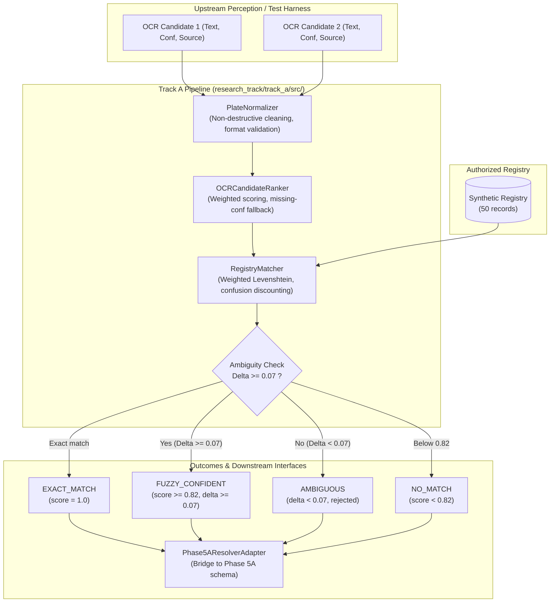

# Track A: Indian ANPR Research & Evaluation Prototype Specification

**Document Version:** 1.0.0  
**Classification:** Research Track Specification (Additive-Only)  
**Location:** `research_track/track_a/SPECIFICATION.md`  
**System Target:** Campus Vehicle Security & Access-Control System, PEC Chandigarh  

---

## 1. System Overview & Architecture

Track A implements an isolated, reproducible research prototype for Indian Automatic Number Plate Recognition (ANPR) post-processing, candidate ranking, and registry-constrained fuzzy matching.



---

## 2. Core Architectural Invariants

Track A strictly enforces seven system invariants:

1. **Non-Destructive Normalization**: Raw OCR strings are immutable and permanently preserved in audit fields. Canonical formatting strips delimiters and normalizes case without silent character rewriting.
2. **Auditable Confusion Variants**: Positional character ambiguities (e.g., $O \leftrightarrow 0$ in numeric blocks, $I \leftrightarrow 1$ in alpha blocks) are generated as alternative hypothesis tuples with explicit penalty costs rather than destructively mutating the primary string.
3. **Transparent Candidate Ranking**: Missing OCR confidence scores default to a neutral $0.50$ without claiming certainty. OCR confidence, candidate ranking score, and registry similarity score are strictly decoupled.
4. **Safety-First Ambiguity Rejection**: If the similarity gap between the top-ranked registry match and the second candidate is less than the ambiguity margin ($\Delta < 0.07$), the match **must** be rejected as `AMBIGUOUS`. The pipeline never gambles or guesses on near-ties.
5. **Decoupled Identity Invariant**: A plate string match is an **observation context**, NOT an authorization grant or human identity assertion. Gate barriers, access policies, and driver identities are separate operational layers.
6. **Prefer UNKNOWN over WRONG RECORD**: In security operations, failing to identify an authorized vehicle (`NO_MATCH` or `AMBIGUOUS`) triggers a benign manual guard inspection. Misattributing an unauthorized vehicle (`FALSE_MATCH`) is a critical security failure.
7. **Complete Environmental Isolation**: Research code operates purely offline under `research_track/track_a/`. Zero modifications to existing codebase files (`git diff --stat == 0`), zero open ports, zero database calls, and zero CUDA/GPU resource consumption.

---

## 3. Data Models & Interface Contracts

All entities are defined as immutable Python dataclasses in `research_track/track_a/src/`:

### 3.1 `NormalizedPlate`
Represents the result of canonical cleaning and structural Indian syntax parsing.
```python
@dataclass(frozen=True)
class NormalizedPlate:
    raw_text: str                               # Original unedited OCR string
    clean_text: str                             # Stripped, uppercase alphanumeric string
    is_valid_format: bool                       # Conforms to Indian plate syntax regex
    format_type: str                            # 'STANDARD', 'BHARAT_SERIES', 'MILITARY', 'DIPLOMATIC', 'UNKNOWN'
    state_code: Optional[str] = None            # 2-letter RTO code (e.g. 'PB', 'CH', 'HR')
    district_code: Optional[str] = None         # 2-digit RTO district code (e.g. '65', '01')
    series_code: Optional[str] = None           # 1-2 letter registration series (e.g. 'AK', 'AB')
    number_code: Optional[str] = None           # 4-digit unique registration number (e.g. '1122')
    confusion_variants: List[Tuple[str, float, str]] = field(default_factory=list) # (variant_str, penalty, explanation)
    validation_notes: List[str] = field(default_factory=list)
```

### 3.2 `OCRCandidate` & `RankedCandidate`
Represents raw reader hypotheses and their scored ranking.
```python
@dataclass(frozen=True)
class OCRCandidate:
    raw_text: str                               # Plate text from OCR engine
    source: str                                 # Source identifier (e.g. 'camera_primary', 'paddleocr_vl')
    confidence: Optional[float] = None          # Model confidence score in [0.0, 1.0], or None
    provenance: Dict[str, Any] = field(default_factory=dict)
    normalized: Optional[NormalizedPlate] = None

@dataclass(frozen=True)
class RankedCandidate:
    candidate: OCRCandidate
    rank: int                                   # 1-based rank position
    ranking_score: float                        # Weighted composite score in [0.0, 1.0]
    has_confidence: bool                        # False if confidence was imputed
    component_scores: Dict[str, float]          # Detailed sub-scores (confidence, format, length, source)
    explanation: str                            # Auditable justification
```

### 3.3 `RegistryRecord` & `RegistryMatchResult`
Represents campus registry entries and the resolution outcome.
```python
@dataclass(frozen=True)
class RegistryRecord:
    registry_id: str                            # Unique registry identifier (e.g. 'REG-011')
    plate: str                                  # Clean normalized plate string (e.g. 'CH01AB1234')
    raw_plate: str = ""                         # Human-entered plate with spacing/hyphens
    vehicle_type: str = "CAR"                   # 'CAR', 'TWO_WHEELER', 'COMMERCIAL', etc.
    owner_category: str = "UNKNOWN"             # 'FACULTY', 'STAFF', 'STUDENT', 'VISITOR', 'VENDOR'
    status: str = "ACTIVE"                      # 'ACTIVE', 'REVOKED', 'EXPIRED'

class MatchStatus(str, Enum):
    EXACT_MATCH = "EXACT_MATCH"
    FUZZY_CONFIDENT = "FUZZY_CONFIDENT"
    AMBIGUOUS = "AMBIGUOUS"
    NO_MATCH = "NO_MATCH"
    INVALID_INPUT = "INVALID_INPUT"

@dataclass(frozen=True)
class RegistryMatchResult:
    status: MatchStatus                         # Final categorical decision
    matched_record: Optional[RegistryRecord]    # None if AMBIGUOUS or NO_MATCH
    matched_plate: Optional[str]                # None if AMBIGUOUS or NO_MATCH
    similarity_score: float                     # Top candidate similarity score in [0.0, 1.0]
    score_margin: float                         # Delta between top-1 and top-2 scores
    qualifying_candidates: List[MatchCandidate] # Top qualifying registry matches
    is_ambiguous: bool                          # True if score_margin < ambiguity_margin
    threshold_used: float                       # Configured min similarity threshold (0.82)
    ambiguity_margin_used: float                # Configured ambiguity margin (0.07)
    algorithm_used: str                         # 'weighted_levenshtein' or 'exact_hash'
    explanation: str
```

---

## 4. Configuration Schema (`config.yaml`)

| Parameter | Type | Default | Valid Range | Rationale |
| :--- | :--- | :--- | :--- | :--- |
| `normalization.strip_separators` | bool | `true` | `true`, `false` | Strips hyphens, dots, and whitespace before matching. |
| `normalization.to_uppercase` | bool | `true` | `true`, `false` | Canonical uppercase standard. |
| `normalization.min_length` | int | `6` | `4` – `8` | Minimum viable plate length for Indian vehicles. |
| `normalization.max_length` | int | `12` | `10` – `14` | Maximum allowable plate length including state/series. |
| `candidate_ranking.default_confidence` | float | `0.50` | `0.10` – `0.90` | Neutral default when OCR engine emits null confidence. |
| `candidate_ranking.weights.ocr_confidence` | float | `0.50` | `0.0` – `1.0` | Weight assigned to model confidence. |
| `candidate_ranking.weights.format_validity` | float | `0.35` | `0.0` – `1.0` | Weight assigned to Indian regex conformance. |
| `candidate_ranking.weights.length_plausibility` | float | `0.15` | `0.0` – `1.0` | Weight assigned to 8-10 character standard length. |
| `registry_matcher.min_similarity_threshold` | float | `0.82` | `0.70` – `0.95` | Cutoff below which candidates are declared `NO_MATCH`. |
| `registry_matcher.ambiguity_margin` | float | `0.07` | `0.03` – `0.15` | Delta required between top-1 and top-2 to avoid ambiguity. |
| `registry_matcher.ocr_confusion_penalty` | float | `0.25` | `0.10` – `0.50` | Levenshtein cost for optical pairs ($O/0, I/1, B/8$). |
| `registry_matcher.non_confusion_penalty` | float | `1.00` | `0.50` – `2.00` | Levenshtein cost for unrelated character substitutions. |

---

## 5. Phase 5A Resolver Compatibility Mapping

The existing Phase 5A identity resolution contract (`scripts/prototypes/phase5_identity_resolution/resolver.py`) is supported via `Phase5AResolverAdapter`:

| Track A Entity / Field | Phase 5A Schema Target | Mapping Logic & Behavior |
| :--- | :--- | :--- |
| `RankedCandidate[0].candidate.raw_text` | `observation["plate"]` | Selects highest-ranked OCR hypothesis. |
| `RankedCandidate[0].candidate.confidence` | `observation["plate_confidence"]` | Preserves confidence (or None). |
| `MatchStatus.EXACT_MATCH` | `ResolutionResult.identity_status = KNOWN` | `match_method = EXACT_NORMALIZED` |
| `MatchStatus.FUZZY_CONFIDENT` | `ResolutionResult.identity_status = KNOWN` | `match_method = FUZZY_CONFIDENT` |
| `MatchStatus.AMBIGUOUS` | `ResolutionResult.identity_status = AMBIGUOUS` | `match_method = AMBIGUOUS_CANDIDATES`, `vehicle = None` |
| `MatchStatus.NO_MATCH` | `ResolutionResult.identity_status = UNKNOWN` | `match_method = NO_CANDIDATE`, `vehicle = None` |
| `MatchStatus.INVALID_INPUT` | `ResolutionResult.identity_status = INVALID` | `match_method = INVALID_INPUT`, `vehicle = None` |
| `RegistryRecord` | `ResolutionResult.vehicle` | Mapped dict: `id`, `plate`, `category`, `status`. |
