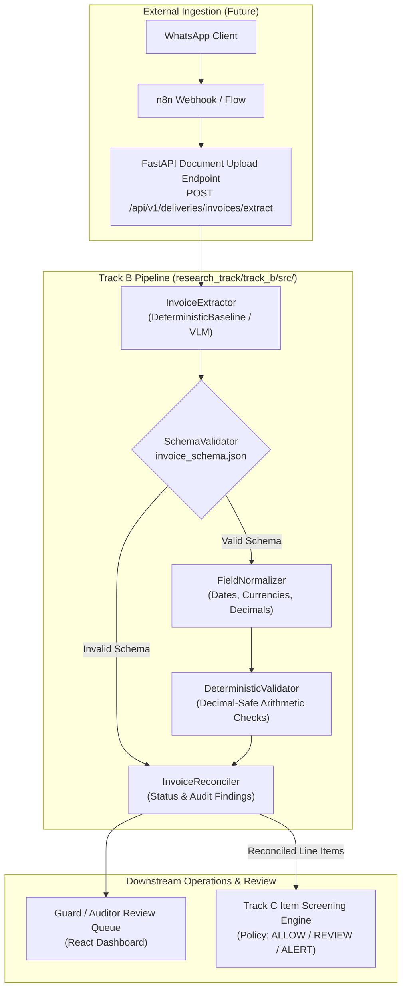

# Track B: Technical Specification & System Architecture

**Document Version:** 1.0.0  
**Classification:** Research Track Specification (Additive-Only)  
**Location:** `research_track/track_b/SPECIFICATION.md`  
**System Target:** Campus Vehicle Security & Access-Control System, PEC Chandigarh  

---

## 1. System Overview & Architecture

Track B provides a decoupled, model-independent document parsing and financial reconciliation subsystem for invoice line-item extraction.



---

## 2. Core Architectural & Security Invariants

Track B enforces thirteen non-negotiable project invariants:

1. **Human-in-the-Loop Authority**: The extraction system never autonomously authorizes gate access, approves vehicle entry, or releases deliveries. Guards and human auditors remain the sole operational decision makers.
2. **No Physical Barrier Actuation**: Document parsing code has zero direct or indirect connection to physical gate barrier relays or controllers.
3. **Observation $\neq$ Decision**: An extracted invoice is an observational artifact describing what a piece of paper claims. It is not an institutional permit or an authorization grant.
4. **Untrusted Model Outputs**: Every model hypothesis is untrusted until structurally validated against `schemas/invoice_schema.json` and deterministically reconciled.
5. **No Synthetic Guesses**: The system must never invent or hallucinate a value for an absent field. Unknown or unreadable values must be explicitly recorded as `null`.
6. **Confidence Scores $\neq$ Correctness**: A high neural confidence score (e.g. 0.99) is treated as model certainty, not mathematical proof of financial truth.
7. **Non-Destructive Reconciliation**: Arithmetic validation findings must never overwrite, mutate, or fabricate extracted values to force mathematical balance.
8. **Provenance & Audit Preservation**: Human corrections must remain distinguishable from raw model extractions in audit records.
9. **Decimal-Safe Financial Arithmetic**: All financial calculations must strictly use Python `decimal.Decimal` with explicit rounding policies to eliminate IEEE 754 binary floating-point drift.
10. **Decoupled Item Screening (Track C)**: Extraction describes what an invoice says; it does not classify items into security policy categories (`TOBACCO_NICOTINE`, `ALCOHOL`, etc.). Screening belongs exclusively to Track C.
11. **Append-Only Event Ledger**: Invoice extractions and audit findings are append-only. No historical records are hard-deleted.
12. **Complete Sandbox Isolation**: All Track B research files reside strictly in `research_track/track_b/`. Zero modifications to existing codebase files (`git diff --stat == 0`).
13. **Zero Resource Intrusion**: Zero dev servers, zero database connections, zero open ports, and zero CUDA/GPU memory usage during development.

---

## 3. Data Contracts & Versioned JSON Schemas

### 3.1 Invoice Document Schema (`schemas/invoice_schema.json`)
Represents parsed invoice metadata, line items, and financial totals:
- **`schema_version`**: `"1.0.0"`
- **`document_id`**: String unique identifier.
- **`invoice_number`**: String or null.
- **`invoice_date`**: ISO 8601 string (`YYYY-MM-DD`) or null.
- **`supplier_name`**: String or null.
- **`currency`**: ISO 4217 code (`INR`, `USD`, `EUR`, `GBP`) or null.
- **`line_items`**: Array of `LineItem` objects:
  - `line_item_id`, `description`, `normalized_description`
  - `quantity`, `unit`, `unit_price`, `discount_amount`, `tax_rate`, `tax_amount`, `line_total` (all decimal-safe strings `^-?[0-9]+(\.[0-9]+)?$`)
  - `currency`, `source_page`, `evidence`, `field_confidence`, `missing_fields`, `validation_warnings`
- **`totals`**: Object containing `subtotal`, `discount_total`, `tax_total`, `shipping_total`, `grand_total`, `amount_paid`, `amount_due`.
- **`extraction_metadata`**: Object recording `extractor_name`, `extractor_version`, `extraction_timestamp`, `provenance`, `review_status`.

### 3.2 Extraction Result Schema (`schemas/extraction_result_schema.json`)
Represents extraction execution, competing candidate hypotheses, validation findings, and audit state:
- **`document_id`**: String.
- **`extractor_name`**, **`extractor_version`**, **`execution_timestamp`**, **`latency_ms`**.
- **`candidates`**: List of candidate extractions with `candidate_id`, `ranking_score`, and `invoice`.
- **`selected_candidate_id`**: String ID of primary candidate.
- **`reconciliation_status`**: Categorical status (`RECONCILED`, `RECONCILED_WITH_WARNINGS`, `DISCREPANCY_FLAGGED`, `CRITICAL_ARITHMETIC_FAILURE`, `SCHEMA_VALIDATION_ERROR`).
- **`requires_human_review`**: Boolean flag.
- **`validation_findings`**: List of structured `ValidationFinding` records.
- **`schema_validation_errors`**: List of JSON schema validation failure messages.
- **`raw_output`**: Preserved raw model or OCR text.

---

## 4. Deterministic Validation Semantics & Reason Codes

| Reason Code | Severity | Trigger Condition | Requires Review? |
| :--- | :--- | :--- | :--- |
| `VAL_LINE_ARITHMETIC_MISMATCH` | `ERROR` | $\|(\text{qty} \times \text{unit\_price} - \text{discount}) - \text{line\_total}\| > 0.02$ | **Yes** |
| `VAL_LINE_DISCOUNT_INVALID` | `WARNING` | Line discount exceeds gross line total | **Yes** |
| `VAL_LINE_TAX_MISMATCH` | `WARNING` | Stated tax differs from line total $\times$ tax rate by $> 0.05$ | No |
| `VAL_NEGATIVE_QUANTITY` | `WARNING` | Quantity $< 0.00$ (credit note / return item) | **Yes** |
| `VAL_NEGATIVE_UNIT_PRICE` | `ERROR` | Unit price $< 0.00$ | **Yes** |
| `VAL_SUBTOTAL_MISMATCH` | `ERROR` | $\|\sum \text{line\_totals} - \text{subtotal}\| > 0.02$ | **Yes** |
| `VAL_TAX_TOTAL_MISMATCH` | `WARNING` | $\|\sum \text{line\_taxes} - \text{tax\_total}\| > 0.05$ | No |
| `VAL_GRAND_TOTAL_MISMATCH` | `CRITICAL` | $\|\text{subtotal} + \text{tax} + \text{ship} - \text{disc} - \text{grand\_total}\| > 0.02$ | **Yes** |
| `VAL_PAYMENT_BALANCE_MISMATCH` | `WARNING` | $\|\text{grand\_total} - \text{amount\_paid} - \text{amount\_due}\| > 0.02$ | **Yes** |
| `VAL_MISSING_MANDATORY_FIELD` | `WARNING`/`CRIT`| Mandatory header or grand total is null | **Yes** |
| `VAL_UNREADABLE_FIELD` | `WARNING` | OCR marks field as unreadable artifact | **Yes** |
| `VAL_CURRENCY_INCONSISTENCY` | `ERROR` | Line currency differs from invoice currency | **Yes** |
| `VAL_DUPLICATE_ITEM_DESCRIPTION`| `INFO` | Same item description repeated on multiple lines | No |
| `VAL_SUSPICIOUS_ROUNDING` | `INFO` | Minor rounding drift within allowable tolerance | No |

---

## 5. WhatsApp $\rightarrow$ n8n $\rightarrow$ FastAPI Future Integration Contract

This section documents the future integration boundary between WhatsApp ingestion, automation webhooks, and the FastAPI backend without implementing it.

### 5.1 End-to-End Workflow Sequence
1. **WhatsApp Webhook Ingestion**: Delivery driver sends an invoice photo or PDF via WhatsApp Business API.
2. **n8n Automation Flow**:
   - Validates webhook signature.
   - Extracts binary image/PDF attachment.
   - Generates unique idempotency hash: `sha256(phone_number + timestamp_window + file_hash)`.
   - Dispatches authenticated POST request to FastAPI internal endpoint.
3. **FastAPI Processing Endpoint**:
   - URL: `POST /api/v1/deliveries/invoices/extract`
   - Headers: `Authorization: Bearer <internal_service_token>`, `X-Idempotency-Key: <hash>`
   - Body: `multipart/form-data` with document file and delivery order metadata.
4. **Execution & Isolation**:
   - Calls `InvoicePipeline.process_document()`.
   - Runs deterministic reconciliation.
   - Persists raw text, normalized payload, and findings to PostgreSQL `invoices` and `invoice_items` tables.
   - Flags invoice in guard review queue if `requires_human_review == True`.

### 5.2 Interface Contract (FastAPI Endpoint Specification)
```json
// POST /api/v1/deliveries/invoices/extract
// Response Payload Contract (200 OK):
{
  "status": "success",
  "document_id": "doc-uuid-1234",
  "reconciliation_status": "RECONCILED",
  "requires_human_review": false,
  "invoice": {
    "invoice_number": "INV-2026-0001",
    "invoice_date": "2026-10-01",
    "supplier_name": "Sharma General Store",
    "currency": "INR",
    "line_items_count": 1,
    "totals": {
      "subtotal": "275.00",
      "grand_total": "275.00"
    }
  },
  "review_queue_id": null
}
```

### 5.3 System Boundaries & Guardrails
- **File Size Ceiling**: Maximum allowable upload size: 10 MB per document; maximum page limit: 5 pages.
- **Idempotency**: Requests with identical `X-Idempotency-Key` return cached extraction results to prevent double-charging or duplicate inventory logging.
- **Zero Autonomous Actions**: The extraction service never calls WhatsApp APIs or sends messages to drivers. All messaging is initiated strictly by the n8n layer upon human guard sign-off.
