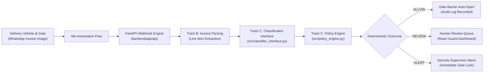

# Track C: Technical Specification & Integration Contract

**Document Version:** 1.0.0  
**Project:** Campus Vehicle Security & Access-Control System, Punjab Engineering College (PEC) Chandigarh  
**System Scope:** Model-Independent Item Classification Interface & Deterministic Screening Policy Engine

---

## 1. System Overview & End-to-End Workflow

Track C operates as the safety-critical classification and decision-making engine within the automated campus gate security workflow. It ingests parsed invoice line items (from Track B) and produces auditable, explainable access decisions (`ALLOW`, `REVIEW`, `ALERT`) for campus guard review.



---

## 2. Formal Architectural Invariants

The Track C architecture enforces 13 non-negotiable security invariants:

1. **Strict Decoupling of Perception and Policy**: Item classification proposes what an item appears to be (`category`, `confidence`); the policy engine deterministically decides what action campus rules mandate (`ALLOW`, `REVIEW`, `ALERT`). A classifier never emits a security outcome.
2. **Confidence is Never an Outcome**: A classification score is an epistemic probability, not an institutional decision. High confidence in an prohibited item triggers `ALERT`; low confidence in a permitted item triggers `REVIEW`.
3. **Pure Deterministic Evaluation**: Given identical inputs, rules, and timestamps, the policy engine produces bit-exact identical outputs. Evaluation is a pure function with zero network, database, or external I/O.
4. **Rule-Order Invariance**: The evaluation result is independent of rule array order or database row sequencing. Rules are ordered strictly by priority (lower integer = higher precedence), with rule IDs acting as a secondary deterministic tie-break for candidates.
5. **Explicit `UNKNOWN` Category**: Unrecognized, unclassifiable, or corrupted items resolve to `UNKNOWN` with `is_uncertain=True`. `UNKNOWN` must **never** be silently converted to `NORMAL`.
6. **Preservation of Missing Confidence**: When a classifier does not emit confidence (e.g. lexical lookup), `confidence` remains strictly `None`. It is never artificially imputed as `0.0` or `1.0`.
7. **Confidence Safety Degradation**: Any candidate `ALLOW` outcome evaluated with confidence below the configured threshold ($\tau = 0.70$) or with `confidence is None` is automatically downgraded to `REVIEW` with reason codes `LOW_CLASSIFIER_CONFIDENCE` or `MISSING_CLASSIFIER_CONFIDENCE`. `ALERT` outcomes are never downgraded.
8. **Deterministic Conflict Safety Fallback**: If two or more rules match at the identical top priority with conflicting actions, the engine emits `POLICY_RULE_CONFLICT` and safely falls back to `REVIEW`. It never resolves conflicts by file order.
9. **Temporal Window Enforcement**: Rules outside their validity window (`effective_from > now` or `effective_to < now`) or with `active == false` are rejected during rule evaluation with audit traces.
10. **Strict Unit Integrity**: Quantity threshold checks require matching unit strings (e.g. `PACK`, `BOTTLE`, `PCS`). No cross-unit assumptions (e.g. 1 KG == 1 PACK) are permitted without domain configuration.
11. **Hazardous Chemical Policy Integrity**: Quantities $\ge 3$ units mandate `REVIEW` with `HAZARDOUS_THRESHOLD_MET`. Quantities $< 3$ allow domestic entry with `HAZARDOUS_THRESHOLD_NOT_MET`. Missing or negative quantities mandate `REVIEW`.
12. **Stable Machine-Readable Reason Codes**: All outcomes are accompanied by standardized uppercase reason code enums (`CATEGORY_RULE_ALERT`, `POLICY_RULE_CONFLICT`, etc.). Code strings never embed PII or unparsed description text.
13. **Complete Audit Traceability**: Every evaluation produces a `RuleEvaluationTrace` recording rules considered, rejected rules with rationale, candidate matches, detected conflicts, and the applied rule ID.

---

## 3. Data Contracts & Schema Specifications

### 3.1 `ClassificationInput` (Ingestion from Track B)
```json
{
  "$schema": "https://json-schema.org/draft/2020-12/schema",
  "type": "object",
  "required": ["line_item_id", "raw_item_description"],
  "properties": {
    "line_item_id": { "type": "string" },
    "raw_item_description": { "type": "string" },
    "normalized_description": { "type": ["string", "null"] },
    "quantity": { "type": ["number", "null"] },
    "unit": { "type": ["string", "null"] },
    "platform": { "type": ["string", "null"] },
    "metadata": { "type": "object" }
  }
}
```

### 3.2 `ClassificationOutput` (Classifier Perception Hypothesis)
```json
{
  "$schema": "https://json-schema.org/draft/2020-12/schema",
  "type": "object",
  "required": [
    "line_item_id",
    "predicted_category",
    "classifier_name",
    "classifier_version",
    "is_uncertain"
  ],
  "properties": {
    "line_item_id": { "type": "string" },
    "predicted_category": {
      "type": "string",
      "enum": [
        "TOBACCO_NICOTINE", "ALCOHOL", "RX_SCHEDULED_DRUG", "OTC_MEDICINE",
        "HAZARDOUS_CHEMICAL", "SHARP_OBJECT", "NORMAL", "UNKNOWN"
      ]
    },
    "confidence": { "type": ["number", "null"], "minimum": 0.0, "maximum": 1.0 },
    "classifier_name": { "type": "string" },
    "classifier_version": { "type": "string" },
    "is_uncertain": { "type": "boolean" },
    "alternative_categories": {
      "type": "array",
      "items": {
        "type": "object",
        "properties": {
          "category": { "type": "string" },
          "confidence": { "type": "number" }
        }
      }
    },
    "prediction_timestamp": { "type": "string" },
    "explanation": { "type": ["string", "null"] }
  }
}
```

### 3.3 `PolicyRule` (Campus Screening Rule Table)
```json
{
  "$schema": "https://json-schema.org/draft/2020-12/schema",
  "type": "object",
  "required": ["rule_id", "category_code", "action", "priority", "policy_version", "active"],
  "properties": {
    "rule_id": { "type": "string" },
    "category_code": { "type": "string" },
    "action": { "type": "string", "enum": ["ALLOW", "REVIEW", "ALERT"] },
    "priority": { "type": "integer", "minimum": 1 },
    "policy_version": { "type": "string" },
    "min_quantity": { "type": ["number", "null"] },
    "max_quantity": { "type": ["number", "null"] },
    "quantity_unit": { "type": ["string", "null"] },
    "platform": { "type": ["string", "null"] },
    "effective_from": { "type": ["string", "null"], "format": "date-time" },
    "effective_to": { "type": ["string", "null"], "format": "date-time" },
    "active": { "type": "boolean" },
    "description": { "type": ["string", "null"] }
  }
}
```

### 3.4 `ScreeningResult` (Final Auditable Outcome)
```json
{
  "$schema": "https://json-schema.org/draft/2020-12/schema",
  "type": "object",
  "required": [
    "screening_event_id",
    "line_item_id",
    "outcome",
    "reason_codes",
    "matched_rule_ids",
    "policy_version",
    "evaluation_timestamp",
    "explanation",
    "requires_human_review",
    "classification_summary",
    "audit_trace"
  ],
  "properties": {
    "screening_event_id": { "type": "string" },
    "line_item_id": { "type": "string" },
    "outcome": { "type": "string", "enum": ["ALLOW", "REVIEW", "ALERT"] },
    "reason_codes": { "type": "array", "items": { "type": "string" } },
    "matched_rule_ids": { "type": "array", "items": { "type": "string" } },
    "policy_version": { "type": "string" },
    "evaluation_timestamp": { "type": "string" },
    "explanation": { "type": "string" },
    "requires_human_review": { "type": "boolean" },
    "classification_summary": { "type": "object" },
    "audit_trace": {
      "type": "object",
      "required": ["rules_considered", "matching_candidates", "rejected_rules", "conflicts_detected", "resolution_method"],
      "properties": {
        "rules_considered": { "type": "integer" },
        "matching_candidates": { "type": "array", "items": { "type": "string" } },
        "rejected_rules": { "type": "object" },
        "conflicts_detected": { "type": "array", "items": { "type": "string" } },
        "applied_rule_id": { "type": ["string", "null"] },
        "resolution_method": { "type": "string" }
      }
    }
  }
}
```

---

## 4. Standard Category Taxonomy & Operational Semantics

| Code | Display Name | Campus Policy Severity | Default Fallback Action | Typical Items |
| :--- | :--- | :--- | :--- | :--- |
| `TOBACCO_NICOTINE` | Tobacco & Nicotine | CRITICAL | `ALERT` | Cigarettes, beedis, gutka, vapes, nicotine pods |
| `ALCOHOL` | Alcoholic Beverages | CRITICAL | `ALERT` | Beer, whisky, rum, vodka, wine, breezers |
| `RX_SCHEDULED_DRUG` | Rx Scheduled Drugs | CRITICAL | `ALERT` | Codeine syrup, sleeping pills, tramadol, steroids |
| `OTC_MEDICINE` | Over-The-Counter Medicine | LOW | `ALLOW` | Paracetamol, lozenges, band-aids, antacids |
| `HAZARDOUS_CHEMICAL` | Hazardous Chemicals | MEDIUM | `REVIEW` ($\ge 3$) / `ALLOW` ($< 3$) | Drain cleaners, acids, rat poison, bulk bleach |
| `SHARP_OBJECT` | Sharp Objects & Blades | MEDIUM | `REVIEW` | Kitchen knives, razor blades, utility box cutters |
| `NORMAL` | Standard Permitted Goods | NONE | `ALLOW` | Groceries, snacks, dairy, drinks, cables, books |
| `UNKNOWN` | Unrecognized Category | HIGH | `REVIEW` | Novel SKUs, garbled OCR tokens, blank strings |

---

## 5. Standard Reason Code Dictionary

| Reason Code | Category | Severity / Escalation | Operational Description |
| :--- | :--- | :--- | :--- |
| `CATEGORY_RULE_ALERT` | RULE_MATCH | CRITICAL (Escalate) | High-risk prohibited category matched rule mandating ALERT. |
| `CATEGORY_RULE_REVIEW` | RULE_MATCH | HIGH (Escalate) | Controlled category matched rule mandating manual guard inspection. |
| `CATEGORY_RULE_ALLOW` | RULE_MATCH | NONE | Item category satisfied all policy criteria for entry. |
| `UNKNOWN_CATEGORY` | PERCEPTION_UNCERTAINTY | HIGH (Escalate) | Product description could not be classified into taxonomy. |
| `LOW_CLASSIFIER_CONFIDENCE` | PERCEPTION_UNCERTAINTY | MEDIUM (Escalate) | Classifier confidence below threshold ($\tau < 0.70$). |
| `MISSING_CLASSIFIER_CONFIDENCE` | PERCEPTION_UNCERTAINTY | MEDIUM (Escalate) | Classifier did not emit a confidence value. |
| `POLICY_RULE_CONFLICT` | POLICY_ANOMALY | HIGH (Escalate) | Two or more active rules at top priority prescribe conflicting actions. |
| `MISSING_QUANTITY` | INPUT_ANOMALY | MEDIUM (Escalate) | Quantity-dependent rule matched but quantity was null. |
| `INVALID_QUANTITY` | INPUT_ANOMALY | MEDIUM (Escalate) | Quantity was negative or non-numerical. |
| `UNSUPPORTED_QUANTITY_UNIT` | INPUT_ANOMALY | MEDIUM (Escalate) | Unit did not match the required rule measurement unit. |
| `HAZARDOUS_THRESHOLD_MET` | THRESHOLD_CONDITION | HIGH (Escalate) | Chemical shipment met or exceeded bulk threshold ($\ge 3$). |
| `HAZARDOUS_THRESHOLD_NOT_MET` | THRESHOLD_CONDITION | NONE | Domestic chemical shipment was below threshold ($< 3$). |
| `MANUAL_REVIEW_REQUIRED` | POLICY_ANOMALY | HIGH (Escalate) | Catch-all flag mandating human guard review queue routing. |

---

## 6. Downstream Database Integration Boundary

When promoted from research track to production, results map directly to `research_track/db_draft/models_screening.py`:
- `ClassificationOutput` maps to `InvoiceLineClassification`
- `ScreeningResult` maps to `InvoiceScreeningResult`
- `RuleEvaluationTrace` maps to JSONB column `InvoiceScreeningResult.audit_trace`
- `HumanReviewEvent` maps to `HumanReviewQueue` and updates `InvoiceScreeningResult.resolved_outcome`
