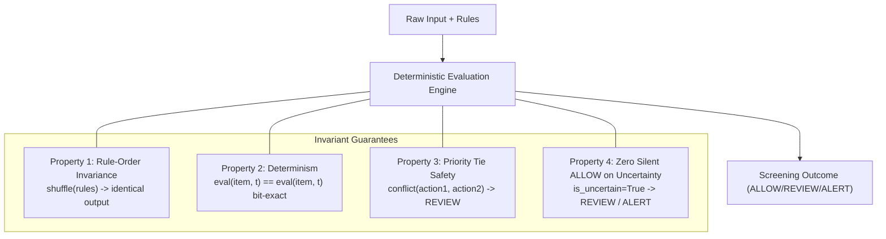

# Track C: Offline Evaluation Plan & Future Model Comparison Framework

**Author / Scope:** Campus Vehicle Security & Access-Control System (PEC Chandigarh) — Research Track C  
**Document Status:** Complete Offline Architecture & Specification  
**Model Execution Status:** DEFERRED (Zero inference/training executed in current phase)

---

## 1. Executive Summary & Evaluation Philosophy

Track C introduces a clean architectural decoupling between **observational classification** (what an invoice line item appears to be) and **deterministic policy enforcement** (what action campus security protocol mandates).

Traditional ML evaluation combines perception and decision-making into a single accuracy or F1 score. In high-consequence perimeter security, this is dangerous:
- An ML classifier predicting "paracetamol" with 65% confidence is a perception problem.
- A gate barrier lifting to admit an unverified shipment is a perimeter breach.
- Treating confidence as an outcome bypasses administrative governance and security audits.

Therefore, this evaluation framework establishes two independent evaluation regimes:
1. **Perception Evaluation**: How accurately does a classification model categorize noisy, multi-lingual, truncated quick-commerce invoice descriptions?
2. **Policy Evaluation**: How deterministically, safely, and verifiably does the rule engine convert classification hypotheses into gate outcomes (`ALLOW`, `REVIEW`, `ALERT`)?

---

## 2. Evaluation Metric Formulations

### 2.1 Independent Perception Metrics

Perception models are evaluated against ground-truth categorical labels $y_i \in \mathcal{C}$ where $\mathcal{C}$ comprises all 8 standardized campus taxonomy codes:
$$\mathcal{C} = \{\text{TOBACCO\_NICOTINE}, \text{ALCOHOL}, \text{RX\_SCHEDULED\_DRUG}, \text{OTC\_MEDICINE}, \text{HAZARDOUS\_CHEMICAL}, \text{SHARP\_OBJECT}, \text{NORMAL}, \text{UNKNOWN}\}$$

| Metric | Mathematical Definition | Target Threshold | Security Interpretation |
| :--- | :--- | :--- | :--- |
| **Categorical Accuracy** | $\frac{1}{N} \sum_{i=1}^N \mathbb{I}(\hat{y}_i = y_i)$ | $\ge 92\%$ | Overall proportion of correct category assignments across all lines. |
| **Macro-F1 Score** | $\frac{1}{|\mathcal{C}|} \sum_{c \in \mathcal{C}} F1_c$ | $\ge 0.88$ | Unweighted average F1 across all classes, preventing class imbalance from masking poor minority-class detection (e.g. rare weapons/chemicals). |
| **Per-Class Recall ($R_c$)** | $\frac{TP_c}{TP_c + FN_c}$ | $\ge 0.95$ (for restricted classes) | The fraction of actual restricted items correctly flagged. Low recall on restricted classes is unacceptable. |
| **UNKNOWN Detection Rate** | $\frac{\sum_{i=1}^N \mathbb{I}(\hat{y}_i = \text{UNKNOWN} \land y_i = \text{UNKNOWN})}{\sum_{i=1}^N \mathbb{I}(y_i = \text{UNKNOWN})}$ | $\ge 90\%$ | Ability of the perception layer to reject out-of-distribution or corrupted invoice text without hallucinating. |
| **Abstention Rate** | $\frac{1}{N} \sum_{i=1}^N \mathbb{I}(\hat{y}_i = \text{UNKNOWN} \lor \text{is\_uncertain}_i = \text{True})$ | Tracked | Measure of model epistemic uncertainty; elevated rates flag OCR noise or emerging product slang. |

---

### 2.2 Independent Policy Engine Metrics

Policy evaluation measures the safety and explainability of the deterministic rules engine given classification hypotheses and contextual attributes (quantity, unit, platform):

| Metric | Mathematical Definition | Target Threshold | Security Interpretation |
| :--- | :--- | :--- | :--- |
| **Outcome Accuracy** | $\frac{1}{N} \sum_{i=1}^N \mathbb{I}(\hat{o}_i = o^*_i)$ | **100.0%** (on valid rules) | Exact agreement between policy output and institutional policy specification $o^* \in \{\text{ALLOW}, \text{REVIEW}, \text{ALERT}\}$. |
| **False-Allow Rate (FAR)** | $\frac{\sum_{i=1}^N \mathbb{I}(\hat{o}_i = \text{ALLOW} \land o^*_i \in \{\text{REVIEW}, \text{ALERT}\})}{\sum_{i=1}^N \mathbb{I}(o^*_i \in \{\text{REVIEW}, \text{ALERT}\})}$ | **0.00% (STRICT ZERO)** | **CRITICAL SECURITY FAILURE.** Proportion of restricted or unverified items incorrectly allowed through the perimeter. |
| **False-Alert Rate** | $\frac{\sum_{i=1}^N \mathbb{I}(\hat{o}_i = \text{ALERT} \land o^*_i \in \{\text{ALLOW}, \text{REVIEW}\})}{\sum_{i=1}^N \mathbb{I}(o^*_i \in \{\text{ALLOW}, \text{REVIEW}\})}$ | $\le 2.0\%$ | Operational friction metric: benign shipments causing false campus security alarms. |
| **Review Rate** | $\frac{1}{N} \sum_{i=1}^N \mathbb{I}(\hat{o}_i = \text{REVIEW})$ | Expected $25 - 35\%$ | Guard workload metric: volume of packages routed to physical manual inspection bay. |
| **Conflict Detection Rate** | $\frac{\sum \mathbb{I}(\text{CONFLICT} \in \text{reasons}_i)}{\sum \mathbb{I}(\text{has\_priority\_tie}_i)}$ | **100.0%** | Safety verification: conflicting rules at equal priority must always trigger `POLICY_RULE_CONFLICT` and route to `REVIEW`. |
| **Reason Code Correctness** | $\frac{1}{N} \sum_{i=1}^N \mathbb{I}(r^*_i \subseteq \text{reasons}_i)$ | **100.0%** | Explainability metric: every evaluation must emit the expected standardized machine-readable reason code. |

---

## 3. Future Model Candidate Comparison Plan

When ML execution is enabled in future research tracks, three classifier paradigms will be benchmarked:

```
+-----------------------------------------------------------------------------------+
|                            Classifier Candidate Matrix                            |
+-----------------------------------------------------------------------------------+
| Model 1: Lexical Mapping (Baseline)                                               |
| - Implementation: research_track/track_c/src/classifier_interface.py             |
| - Approach: Exact & substring matching against seed taxonomy CSV                  |
| - ML Weights: None (deterministic rule-based)                                     |
| - Confidence: Returns None by default (triggers policy confidence degradation)    |
| - Latency: < 0.2 ms / item                                                        |
+-----------------------------------------------------------------------------------+
| Model 2: Zero-Shot Small LLM (Qwen3-1.7B / Qwen2.5-1.5B-Instruct)                |
| - Target Checkpoint: Qwen/Qwen2.5-1.5B-Instruct or Qwen3-1.7B                     |
| - Approach: Structured JSON schema constrained zero-shot prompt                   |
| - Hardware: CPU quantized (llama.cpp / ONNX) or single GPU                        |
| - Licensing: Apache 2.0 / Tongyi Qianwen Open License (Permissive commercial/res) |
| - Expected Strengths: Hinglish slang, quick-commerce abbreviations, unknown token |
+-----------------------------------------------------------------------------------+
| Model 3: Domain Fine-Tuned Encoder (DeBERTa-v3-small / MiniLM-L6)                 |
| - Approach: Supervised classification head fine-tuned on campus delivery corpus   |
| - Hardware: Single GPU training (~1 hr on T4), ultra-fast CPU inference (< 5 ms)  |
| - Strengths: Extremely low latency, calibrated softmax probabilities              |
+-----------------------------------------------------------------------------------+
```

---

## 4. Model Asset & Licensing Audit

### 4.1 Local External Asset Audit (`~/ml-assets/campus/`)
- Audit inspection confirms `~/ml-assets/campus/` contains only `code/Indian_LPR/` (Track A).
- **Blocker Status**: No Qwen or transformer weights are currently present in `~/ml-assets/campus/models/`.
- Downloading model weights or initiating Hugging Face transfers during the current phase is strictly blocked by project isolation rules.
- When activated, weights must be staged under `~/ml-assets/campus/models/track_c_qwen/` and symlinked or mounted read-only.

### 4.2 Licensing & Academic Compliance
- **Qwen2.5 / Qwen3 weights**: Permissive open weights allowing academic and commercial evaluation.
- **FastAPI / SQLAlchemy / Pydantic**: MIT / BSD-3 licenses (fully compatible with PEC Chandigarh campus stack).
- **Synthetic Dataset**: Fully generated synthetic data with zero real user PII, compliant with Indian Digital Personal Data Protection Act (DPDPA 2023).

---

## 5. Property-Based Verification Plan

In addition to static test suite accuracy, the policy engine must undergo property-based invariant verification:



### Invariant 1: Rule-Order Invariance
Given an arbitrary permutation $\pi(\mathcal{R})$ of policy rules $\mathcal{R}$, for all inputs $x$:
$$\text{Evaluate}(x, \pi(\mathcal{R})) \equiv \text{Evaluate}(x, \mathcal{R})$$
Verified by `MetricCalculator.verify_rule_order_invariance()`.

### Invariant 2: Pure Determinism
Repeated evaluation across $K$ runs produces bit-exact equality:
$$\text{Evaluate}_1(x, \mathcal{R}) == \text{Evaluate}_2(x, \mathcal{R}) == \dots == \text{Evaluate}_K(x, \mathcal{R})$$

### Invariant 3: Safety Degradation on Low/Missing Confidence
$$\forall x, \quad \left(\text{confidence}(x) < \tau \lor \text{confidence}(x) = \text{None}\right) \implies \text{Outcome}(x) \ne \text{ALLOW}$$
Verified across test suites S11 and S12.

---

## 6. Execution Command Reference (DEFERRED)

The following commands are prepared for future execution when the project moves from static prototyping to active verification:

```bash
# 1. Run property tests and synthetic case evaluations using Python stdlib runner
python3 -c "
import json
from research_track.track_c.src.types import PolicyRule, ClassificationOutput, ItemCategoryCode
from research_track.track_c.src.policy_engine import DeterministicPolicyEngine
from research_track.track_c.src.evaluation import MetricCalculator

with open('research_track/track_c/fixtures/policy_rules.json') as f:
    rules = [PolicyRule(**r) for r in json.load(f)]
engine = DeterministicPolicyEngine(rules=rules)
print('Policy engine loaded successfully with', len(rules), 'rules.')
"

# 2. Benchmark classifier perception vs ground-truth
# (Deferred until model weights are staged under ~/ml-assets/campus/)
```
